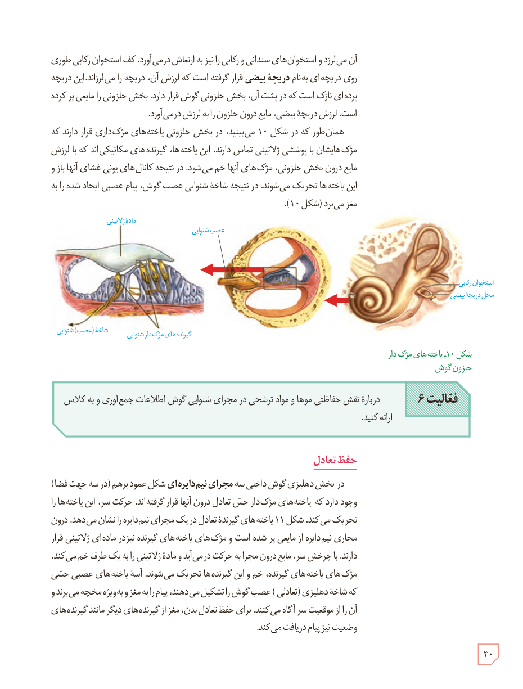

آن می‌لرزد و استخوان‌های سندانی و رکابی را نیز به ارتعاش درمی‌آورد. کف استخوان رکابی طوری روی دریچه‌ای به نام **دریچۀ بیضی** قرار گرفته است که لرزش آن، دریچه را می‌لرزاند. این دریچه پرده‌ای نازک است که در پشت آن، بخش حلزونی گوش قرار دارد. بخش حلزونی را مایعی پر کرده است. لرزش دریچۀ بیضی، مایع درون حلزون را به لرزش درمی‌آورد.

همان‌طور که در شکل ۱۰ می‌بینید، در بخش حلزونی یاخته‌های مژک‌داری قرار دارند که مژک‌هایشان با پوششی ژلاتینی تماس دارند. این یاخته‌ها، گیرنده‌های مکانیکی‌اند که با لرزش مایع درون بخش حلزونی، مژک‌های آنها خم می‌شود. در نتیجه کانال‌های یونی غشای آنها باز و این یاخته‌ها تحریک می‌شوند. در نتیجه شاخۀ شنوایی عصب گوش، پیام عصبی ایجاد شده را به مغز می‌برد (شکل ۱۰).

شکل ۱۰ـ یاخته‌های مژک‌دار حلزون گوش

**فعالیت ۶:** درباره نقش حفاظتی موها و مواد ترشحی در مجرای شنوایی گوش اطلاعات جمع‌آوری و به کلاس ارائه کنید.

## حفظ تعادل

در بخش دهلیزی گوش داخلی سه **مجرای نیم‌دایره‌ای** شکل عمود بر هم (در سه جهت فضا) وجود دارد که یاخته‌های مژک‌دار حس تعادل درون آنها قرار گرفته‌اند. حرکت سر، این یاخته‌ها را تحریک می‌کند. شکل ۱۱ یاخته‌های گیرندۀ تعادل در یک مجرای نیم‌دایره را نشان می‌دهد. درون مجرای نیم‌دایره از مایعی پر شده است و مژک‌های یاخته‌های گیرنده نیز در مادۀ ژلاتینی قرار دارند. با چرخش سر، مایع درون مجرا به حرکت درمی‌آید و مادۀ ژلاتینی را به یک طرف خم می‌کند. مژک‌های یاخته‌های گیرنده، خم و این گیرنده‌ها تحریک می‌شوند. آسه یاخته‌های عصبی حسی که شاخۀ دهلیزی (تعادلی) عصب گوش را تشکیل می‌دهند، پیام را به مغز و به ویژه مخچه می‌برند و آن را از موقعیت سر آگاه می‌کنند. برای حفظ تعادل بدن، مغز از گیرنده‌های دیگری مانند گیرنده‌های وضعیت نیز پیام دریافت می‌کند.

۳۰

