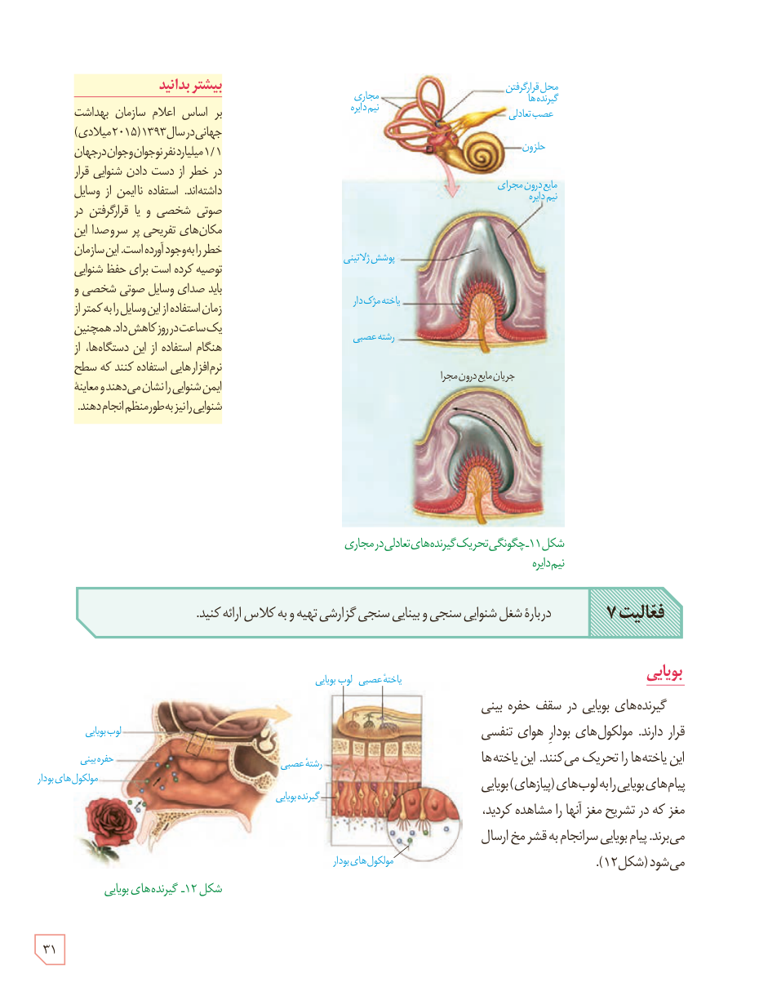

شکل ۱۱ـ چگونگی تحریک گیرنده‌های تعادلی در مجرای نیم‌دایره

**فعالیت ۷:** دربارۀ شغل شنوایی‌سنجی و بینایی‌سنجی گزارشی تهیه و به کلاس ارائه کنید.

## بویایی

گیرنده‌های بویایی در سقف حفرۀ بینی قرار دارند. مولکول‌های بودار هوای تنفسی این یاخته‌ها را تحریک می‌کنند. این یاخته‌ها پیام‌های بویایی را به لوب‌های (پیازهای) بویایی مغز که در تشریح مغز آنها را مشاهده کردید، می‌برند. پیام بویایی سرانجام به قشر مخ ارسال می‌شود (شکل ۱۲).

شکل ۱۲ـ گیرنده‌های بویایی

### بیشتر بدانید

بر اساس اعلام سازمان بهداشت جهانی در سال ۱۳۹۳ (۲۰۱۵ میلادی) ۱/۱ میلیارد نفر نوجوان و جوان در جهان در خطر از دست دادن شنوایی قرار داشته‌اند. استفاده ناایمن از وسایل صوتی شخصی و یا قرار گرفتن در مکان‌های تفریحی پر سر و صدا این خطر را به وجود آورده است. این سازمان توصیه کرده است برای حفظ شنوایی باید صدای وسایل صوتی شخصی و زمان استفاده از این وسایل را به کمتر از یک ساعت در روز کاهش داد. همچنین هنگام استفاده از این دستگاه‌ها، از نرم‌افزارهایی استفاده کنند که سطح ایمن شنوایی را نشان می‌دهند و معاینۀ شنوایی را نیز به‌طور منظم انجام دهند.

۳۱

