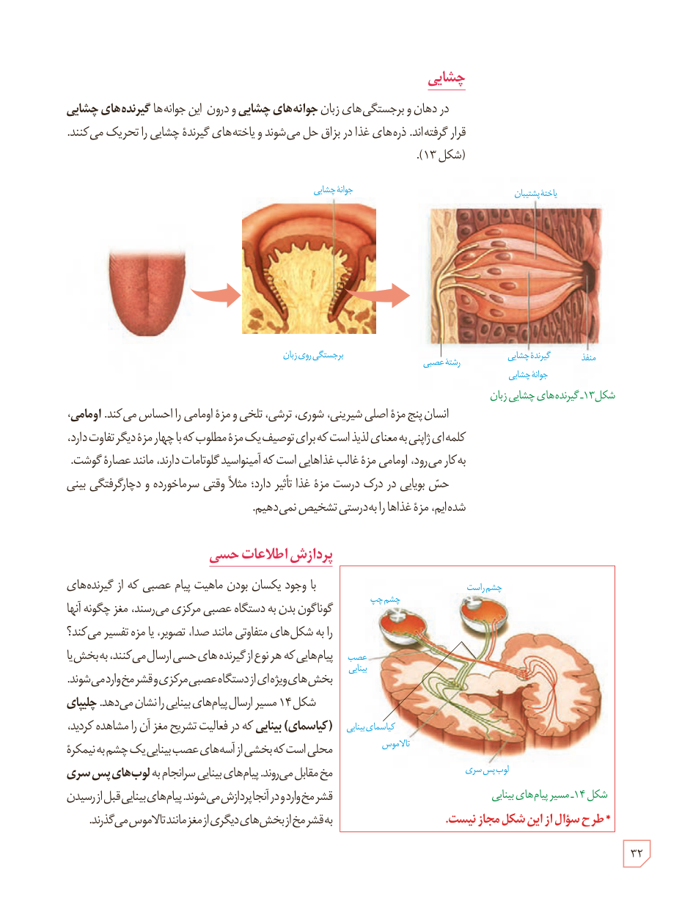

## چشایی

در دهان و برجستگی‌های زبان **جوانه‌های چشایی** و درون این جوانه‌ها **گیرنده‌های چشایی** قرار گرفته‌اند. ذره‌های غذا در بزاق حل می‌شوند و یاخته‌های گیرندۀ چشایی را تحریک می‌کنند (شکل ۱۳).

شکل ۱۳ـ گیرنده‌های چشایی زبان

انسان پنج مزۀ اصلی شیرینی، شوری، ترشی، تلخی و مزۀ اومامی را احساس می‌کند. **اومامی**، کلمه‌ای ژاپنی به معنای لذیذ است که برای توصیف یک مزۀ مطلوب که با چهار مزۀ دیگر تفاوت دارد، به کار می‌رود. اومامی مزۀ غالب غذاهایی است که آمینواسید گلوتامات دارند، مانند عصارۀ گوشت.

حس بویایی در درک درست مزۀ غذا تأثیر دارد؛ مثلاً وقتی سرماخورده و دچار گرفتگی بینی شده‌ایم، مزۀ غذاها را به‌درستی تشخیص نمی‌دهیم.

## پردازش اطلاعات حسی

با وجود یکسان بودن ماهیت پیام عصبی که از گیرنده‌های گوناگون بدن به دستگاه عصبی مرکزی می‌رسند، مغز چگونه آنها را به شکل‌های متفاوتی مانند صدا، تصویر، یا مزه تفسیر می‌کند؟ پیام‌هایی که هر نوع از گیرنده‌های حسی ارسال می‌کنند، به بخشی یا بخش‌های ویژه‌ای از دستگاه عصبی مرکزی و قشر مخ وارد می‌شوند. شکل ۱۴ مسیر ارسال پیام‌های بینایی را نشان می‌دهد. **چلیپای (کیاسمای) بینایی** که در فعالیت تشریح مغز آن را مشاهده کردید، محلی است که بخشی از آسه‌های عصب بینایی یک چشم به نیمکرۀ مخ مقابل می‌روند. پیام‌های بینایی سرانجام به **لوب‌های پس‌سری** قشر مخ وارد و در آنجا پردازش می‌شوند. پیام‌های بینایی قبل از رسیدن به قشر مخ از بخش‌های دیگری از مغز مانند تالاموس می‌گذرند.

شکل ۱۴ـ مسیر پیام‌های بینایی. * طرح سؤال از این شکل مجاز نیست.

۳۲

