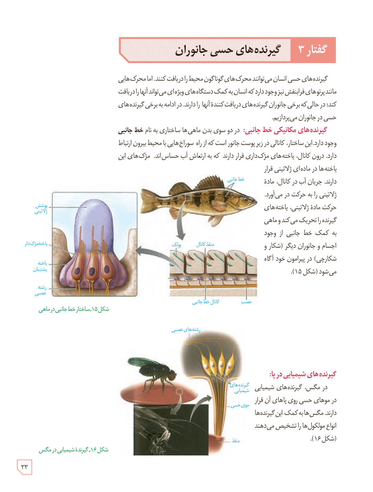

# گفتار ۳: گیرنده‌های حسی جانوران

گیرنده‌های حسی انسان می‌توانند محرک‌های گوناگون محیط را دریافت کنند. اما محرک‌هایی مانند پرتوهای فرابنفش نیز وجود دارد که انسان به کمک دستگاه‌های ویژه‌ای می‌تواند آنها را دریافت کند؛ در حالی که برخی جانوران گیرنده‌های دریافت‌کنندۀ آنها را دارند. در ادامه به برخی گیرنده‌های حسی در جانوران می‌پردازیم.

**گیرنده‌های مکانیکی خط جانبی:** در دو سوی بدن ماهی‌ها ساختاری به نام **خط جانبی** وجود دارد. این ساختار، کانالی در زیر پوست جانور است که از راه سوراخ‌هایی با محیط بیرون ارتباط دارد. درون کانال، یاخته‌های مژک‌داری قرار دارند که به ارتعاش آب حساس‌اند. مژک‌های این یاخته‌ها در ماده‌ای ژلاتینی قرار دارند. جریان آب در کانال، مادۀ ژلاتینی را به حرکت درمی‌آورد. حرکت مادۀ ژلاتینی، یاخته‌های گیرنده را تحریک می‌کند و ماهی به کمک خط جانبی از وجود اجسام و جانوران دیگر (شکار و شکارچی) در پیرامون خود آگاه می‌شود (شکل ۱۵).

**گیرنده‌های شیمیایی در پا:** در مگس، گیرنده‌های شیمیایی در موهای حسی روی پاهای آن قرار دارند. مگس‌ها به کمک این گیرنده‌ها انواع مولکول‌ها را تشخیص می‌دهند (شکل ۱۶).

شکل ۱۵ـ ساختار خط جانبی در ماهی  
شکل ۱۶ـ گیرندۀ شیمیایی در مگس

۳۳

