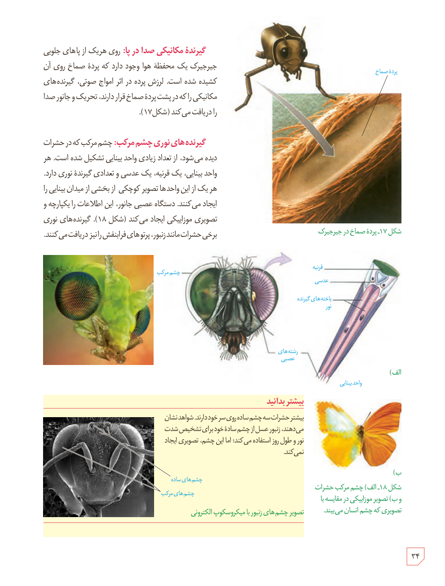

**گیرندۀ مکانیکی صدا در پا:** روی هر یک از پاهای جلویی جیرجیرک یک محفظۀ هوا وجود دارد که پردۀ صماخ روی آن کشیده شده است. لرزش پرده در اثر امواج صوتی، گیرنده‌های مکانیکی را که در پشت پردۀ صماخ قرار دارند، تحریک و جانور صدا را دریافت می‌کند (شکل ۱۷).

**گیرنده‌های نوری چشم مرکب:** چشم مرکب که در حشرات دیده می‌شود، از تعداد زیادی واحد بینایی تشکیل شده است. هر واحد بینایی، یک قرنیه، یک عدسی و تعدادی گیرندۀ نوری دارد. هر یک از این واحدها تصویر کوچکی از بخشی از میدان بینایی را ایجاد می‌کنند. دستگاه عصبی جانور، این اطلاعات را یکپارچه و تصویری موزاییکی ایجاد می‌کند (شکل ۱۸). گیرنده‌های نوری برخی حشرات مانند زنبور، پرتوهای فرابنفش را نیز دریافت می‌کنند.

شکل ۱۷ـ پردۀ صماخ در جیرجیرک  
شکل ۱۸ـ الف) چشم مرکب حشرات و ب) تصویر موزاییکی در مقایسه با تصویری که چشم انسان می‌بیند.

### بیشتر بدانید

بیشتر حشرات سه چشم ساده روی سر خود دارند. شواهد نشان می‌دهند، زنبور عسل از چشم سادۀ خود برای تشخیص شدت نور و طول روز استفاده می‌کند؛ اما این چشم، تصویری ایجاد نمی‌کند.

تصویر چشم‌های زنبور با میکروسکوپ الکترونی

۳۴

