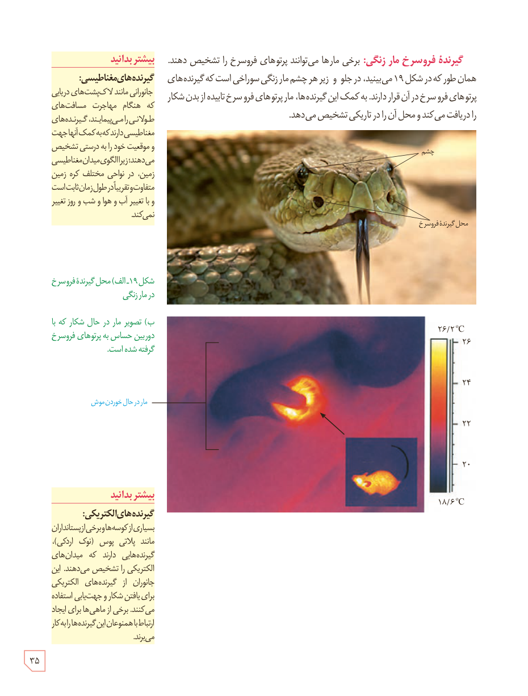

**گیرندۀ فروسرخ مار زنگی:** برخی مارها می‌توانند پرتوهای فروسرخ را تشخیص دهند. همان‌طور که در شکل ۱۹ می‌بینید، در جلو و زیر هر چشم مار زنگی سوراخی است که گیرنده‌های پرتوهای فروسرخ در آن قرار دارند. به کمک این گیرنده‌ها، مار پرتوهای فروسرخ تابیده از بدن شکار را دریافت می‌کند و محل آن را در تاریکی تشخیص می‌دهد.

شکل ۱۹ـ الف) محل گیرندۀ فروسرخ در مار زنگی؛ ب) تصویر مار در حال شکار که با دوربین حساس به پرتوهای فروسرخ گرفته شده است.

### بیشتر بدانید: گیرنده‌های مغناطیسی

جانورانی مانند لاک‌پشت‌های دریایی که هنگام مهاجرت مسافت‌های طولانی را می‌پیمایند، گیرنده‌های مغناطیسی دارند که به کمک آنها جهت و موقعیت خود را به درستی تشخیص می‌دهند؛ زیرا الگوی میدان مغناطیسی زمین، در نواحی مختلف کرۀ زمین متفاوت و تقریباً در طول زمان ثابت است و با تغییر آب و هوا و شب و روز تغییر نمی‌کند.

### بیشتر بدانید: گیرنده‌های الکتریکی

بسیاری از کوسه‌ها و برخی از پستانداران مانند پلاتی‌پوس (نوک اردکی)، گیرنده‌هایی دارند که میدان‌های الکتریکی را تشخیص می‌دهند. این جانوران از گیرنده‌های الکتریکی برای یافتن شکار و جهت‌یابی استفاده می‌کنند. برخی از ماهی‌ها برای ایجاد ارتباط با همنوعان این گیرنده‌ها را به کار می‌برند.

۳۵

