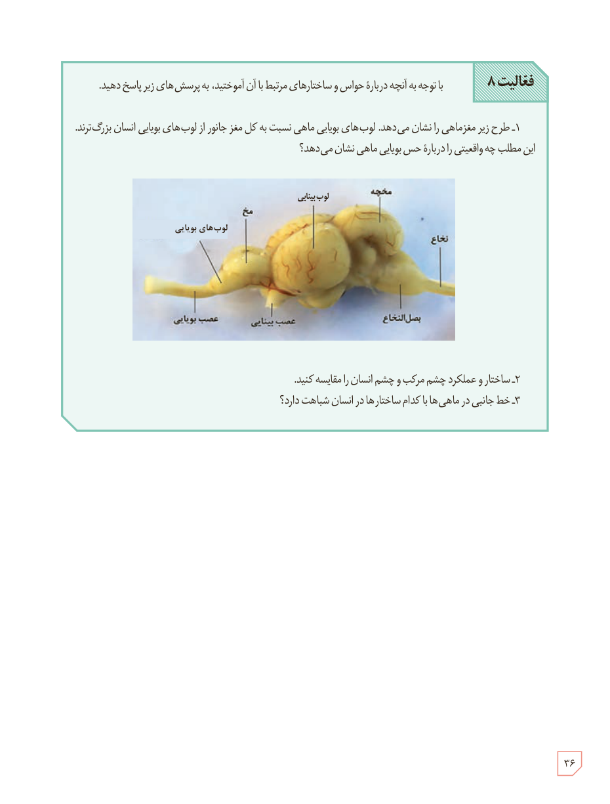

# فعالیت ۸

با توجه به آنچه دربارۀ حواس و ساختارهای مرتبط با آن آموختید، به پرسش‌های زیر پاسخ دهید.

۱- طرح زیر مغز ماهی را نشان می‌دهد. لوب‌های بویایی ماهی نسبت به کل مغز جانور از لوب‌های بویایی انسان بزرگ‌ترند. این مطلب چه واقعیتی را دربارۀ حس بویایی ماهی نشان می‌دهد؟

۲- ساختار و عملکرد چشم مرکب و چشم انسان را مقایسه کنید.

۳- خط جانبی در ماهی‌ها با کدام ساختارها در انسان شباهت دارد؟

۳۶

