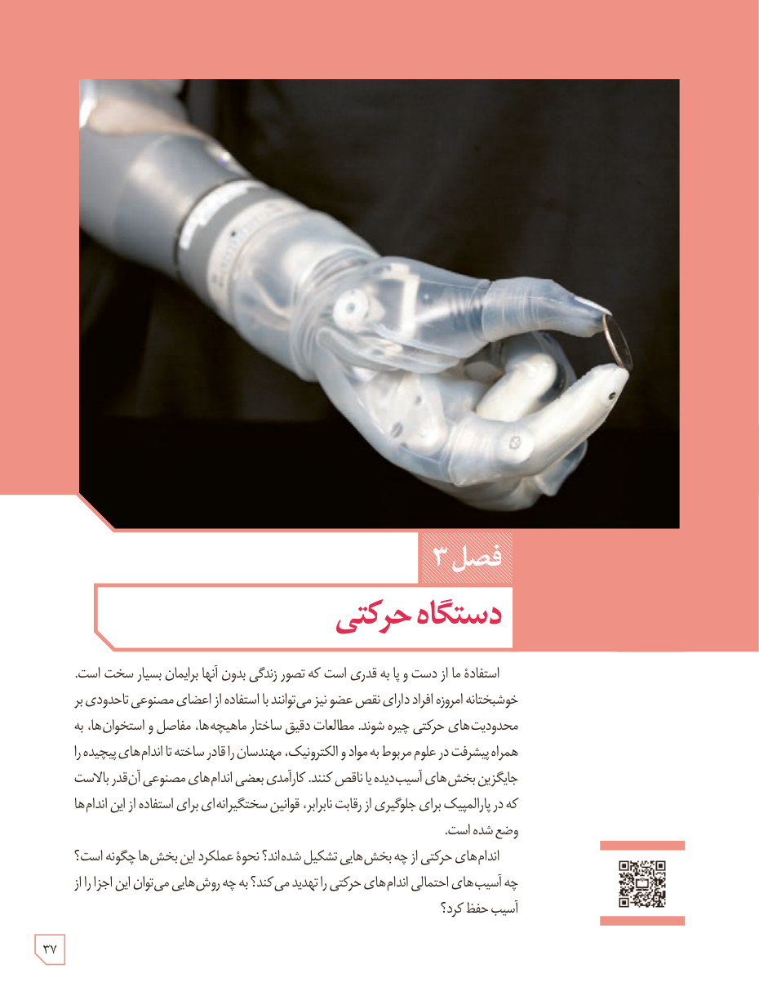

# فصل ۳: دستگاه حرکتی

استفادۀ ما از دست و پا به قدری است که تصور زندگی بدون آنها برایمان بسیار سخت است. خوشبختانه امروزه افراد دارای نقص عضو نیز می‌توانند با استفاده از اعضای مصنوعی تا حدودی بر محدودیت‌های حرکتی چیره شوند. مطالعات دقیق ساختار ماهیچه‌ها، مفاصل و استخوان‌ها، به همراه پیشرفت در علوم مربوط به مواد و الکترونیک، مهندسان را قادر ساخته تا اندام‌های پیچیده را جایگزین بخش‌های آسیب‌دیده یا ناقص کنند. کارآمدی بعضی اندام‌های مصنوعی آن‌قدر بالاست که در پارالمپیک برای جلوگیری از رقابت نابرابر، قوانین سختگیرانه‌ای برای استفاده از این اندام‌ها وضع شده است.

اندام‌های حرکتی از چه بخش‌هایی تشکیل شده‌اند؟ نحوۀ عملکرد این بخش‌ها چگونه است؟ چه آسیب‌های احتمالی اندام‌های حرکتی را تهدید می‌کند؟ به چه روش‌هایی می‌توان این اجزا را از آسیب حفظ کرد؟

۳۷

