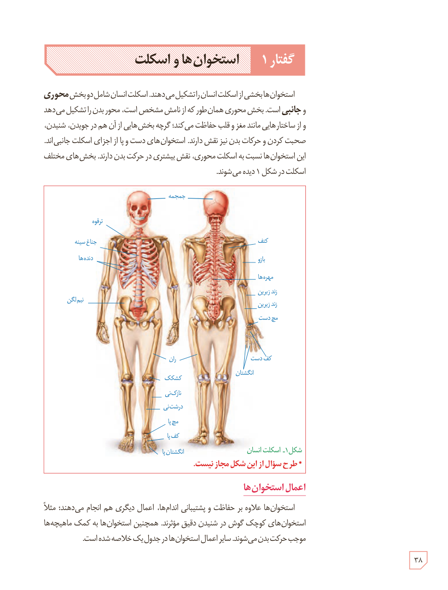

# گفتار ۱: استخوان‌ها و اسکلت

استخوان‌ها بخشی از اسکلت انسان را تشکیل می‌دهند. اسکلت انسان شامل دو بخش **محوری و جانبی** است. بخش محوری همان‌طور که از نامش مشخص است، محور بدن را تشکیل می‌دهد و از ساختارهایی مانند مغز و قلب حفاظت می‌کند؛ گرچه بخش‌هایی از آن هم در جویدن، شنیدن، صحبت کردن و حرکات بدن نیز نقش دارند. استخوان‌های دست و پا از اجزای اسکلت جانبی‌اند. این استخوان‌ها نسبت به اسکلت محوری، نقش بیشتری در حرکت بدن دارند. بخش‌های مختلف اسکلت در شکل ۱ دیده می‌شوند.

شکل ۱ـ اسکلت انسان. * طرح سؤال از این شکل مجاز نیست.

## اعمال استخوان‌ها

استخوان‌ها علاوه بر حفاظت و پشتیبانی اندام‌ها، اعمال دیگری هم انجام می‌دهند؛ مثلاً استخوان‌های کوچک گوش در شنیدن دقیق مؤثرند. همچنین استخوان‌ها به کمک ماهیچه‌ها موجب حرکت بدن می‌شوند. سایر اعمال استخوان‌ها در جدول یک خلاصه شده است.

۳۸

