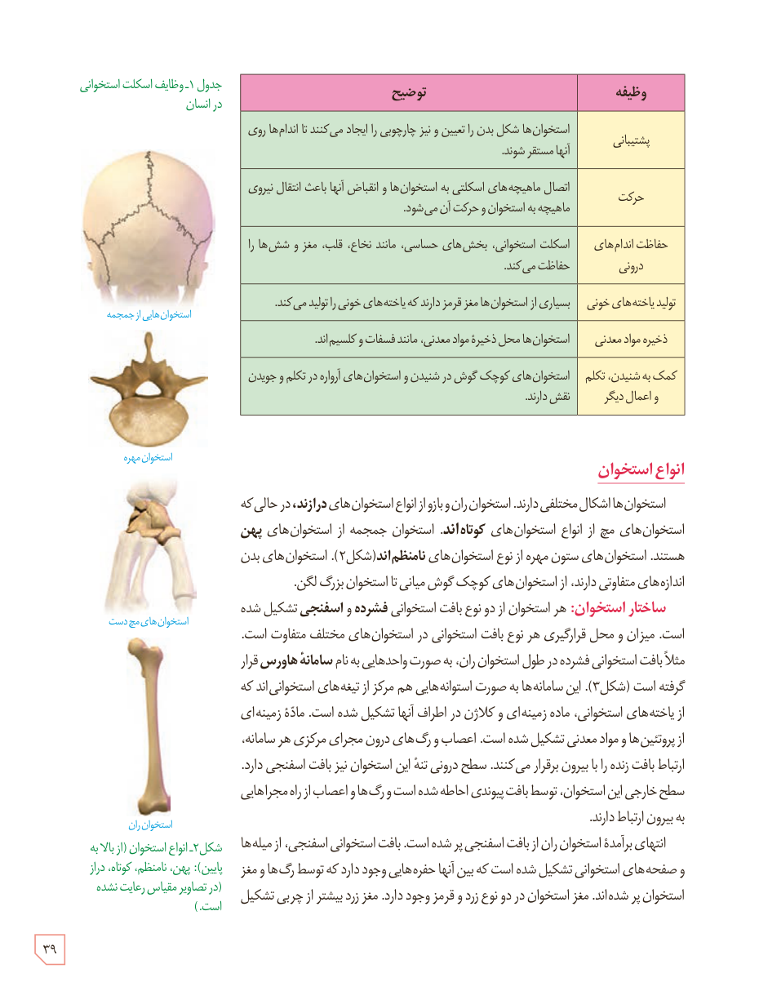

### جدول ۱ـ وظایف اسکلت استخوانی در انسان

| وظیفه | توضیح |
|---|---|
| پشتیبانی | استخوان‌ها شکل بدن را تعیین و نیز چارچوبی را ایجاد می‌کنند تا اندام‌ها روی آنها مستقر شوند. |
| حرکت | اتصال ماهیچه‌های اسکلتی به استخوان‌ها و انقباض آنها باعث انتقال نیروی ماهیچه به استخوان و حرکت آن می‌شود. |
| حفاظت اندام‌های درونی | اسکلت استخوانی، بخش‌های حساس، مانند نخاع، قلب، مغز و شش‌ها را حفاظت می‌کند. |
| تولید یاخته‌های خونی | بسیاری از استخوان‌ها مغز قرمز دارند که یاخته‌های خونی را تولید می‌کند. |
| ذخیرۀ مواد معدنی | استخوان‌ها محل ذخیرۀ مواد معدنی، مانند فسفات و کلسیم‌اند. |
| کمک به شنیدن، تکلم و اعمال دیگر | استخوان‌های کوچک گوش در شنیدن و استخوان‌های آرواره در تکلم و جویدن نقش دارند. |

## انواع استخوان

استخوان‌ها اشکال مختلفی دارند. استخوان ران و بازو از انواع استخوان‌های **دراز**ند، در حالی که استخوان‌های مچ از انواع استخوان‌های **کوتاه**اند. استخوان جمجمه از استخوان‌های **پهن** هستند. استخوان‌های ستون مهره از نوع استخوان‌های **نامنظم**اند (شکل ۲). استخوان‌های بدن اندازه‌های متفاوتی دارند، از استخوان‌های کوچک گوش میانی تا استخوان بزرگ لگن.

**ساختار استخوان:** هر استخوان از دو نوع بافت استخوانی **فشرده و اسفنجی** تشکیل شده است. میزان و محل قرارگیری هر نوع بافت استخوانی در استخوان‌های مختلف متفاوت است. مثلاً بافت استخوانی فشرده در طول استخوان ران، به صورت واحدهایی به نام **سامانۀ هاورس** قرار گرفته است (شکل ۳). این سامانه‌ها به صورت استوانه‌هایی هم‌مرکز از تیغه‌های استخوانی‌اند که از یاخته‌های استخوانی، مادۀ زمینه‌ای و کلاژن در اطراف آنها تشکیل شده است. مادۀ زمینه‌ای از پروتئین‌ها و مواد معدنی تشکیل شده است. اعصاب و رگ‌های درون مجرای مرکزی هر سامانه، ارتباط بافت زنده را با بیرون برقرار می‌کنند. سطح درونی تنۀ این استخوان نیز بافت اسفنجی دارد. سطح خارجی این استخوان، توسط بافت پیوندی احاطه شده است و رگ‌ها و اعصاب از راه مجراهایی به بیرون ارتباط دارند.

انتهای برآمدۀ استخوان ران از بافت اسفنجی پر شده است. بافت استخوانی اسفنجی، از میله‌ها و صفحه‌های استخوانی تشکیل شده است که بین آنها حفره‌هایی وجود دارد که توسط رگ‌ها و مغز استخوان پر شده‌اند. مغز استخوان در دو نوع زرد و قرمز وجود دارد. مغز زرد بیشتر از چربی تشکیل

شکل ۲ـ انواع استخوان (از بالا به پایین): پهن، نامنظم، کوتاه، دراز (در تصاویر مقیاس رعایت نشده است.)

۳۹

