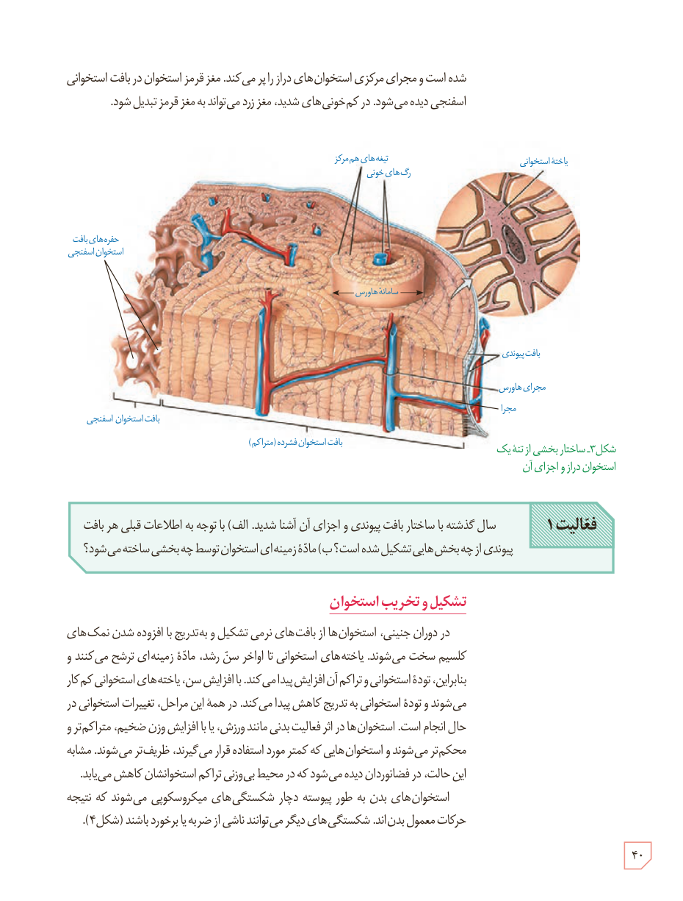

شده است و مجرای مرکزی استخوان‌های دراز را پر می‌کند. مغز قرمز استخوان در بافت استخوانی اسفنجی دیده می‌شود. در کم‌خونی‌های شدید، مغز زرد می‌تواند به مغز قرمز تبدیل شود.

شکل ۳ـ ساختار بخشی از تنۀ یک استخوان دراز و اجزای آن

**فعالیت ۱:** سال گذشته با ساختار بافت پیوندی و اجزای آن آشنا شدید. الف) با توجه به اطلاعات قبلی هر بافت پیوندی از چه بخش‌هایی تشکیل شده است؟ ب) مادۀ زمینه‌ای استخوان توسط چه بخشی ساخته می‌شود؟

## تشکیل و تخریب استخوان

در دوران جنینی، استخوان‌ها از بافت‌های نرمی تشکیل و به‌تدریج با افزوده شدن نمک‌های کلسیم سخت می‌شوند. یاخته‌های استخوانی تا اواخر سن رشد، مادۀ زمینه‌ای ترشح می‌کنند و بنابراین، تودۀ استخوانی و تراکم آن افزایش پیدا می‌کند. با افزایش سن، یاخته‌های استخوانی کم‌کار می‌شوند و تودۀ استخوانی به‌تدریج کاهش پیدا می‌کند. در همۀ این مراحل، تغییرات استخوانی در حال انجام است. استخوان‌ها در اثر فعالیت بدنی مانند ورزش، یا با افزایش وزن ضخیم، متراکم‌تر و محکم‌تر می‌شوند و استخوان‌هایی که کمتر مورد استفاده قرار می‌گیرند، ظریف‌تر می‌شوند. مشابه این حالت، در فضانوردان دیده می‌شود که در محیط بی‌وزنی تراکم استخوانشان کاهش می‌یابد.

استخوان‌های بدن به‌طور پیوسته دچار شکستگی‌های میکروسکوپی می‌شوند که نتیجۀ حرکات معمول بدن‌اند. شکستگی‌های دیگر می‌توانند ناشی از ضربه یا برخورد باشند (شکل ۴).

۴۰

