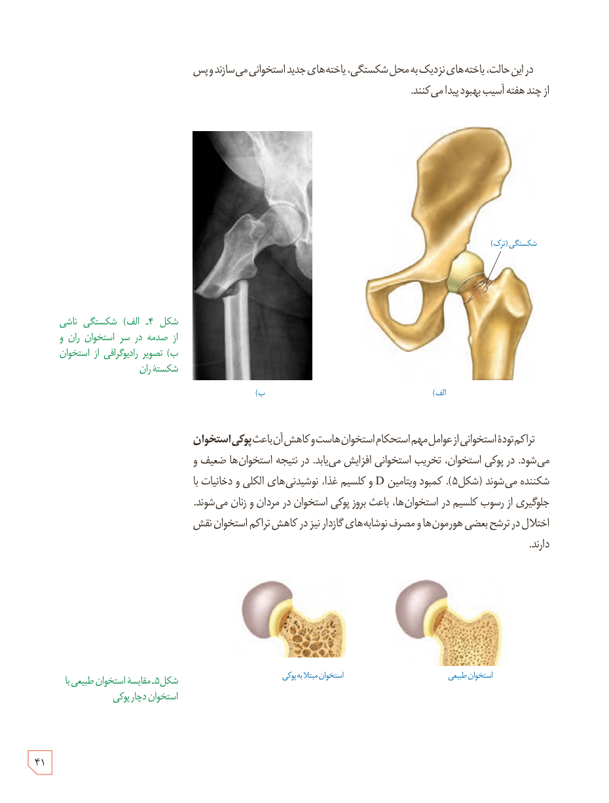

در این حالت، یاخته‌های نزدیک به محل شکستگی، یاخته‌های جدید استخوانی می‌سازند و پس از چند هفته آسیب بهبود پیدا می‌کند.

شکل ۴ـ الف) شکستگی ناشی از صدمه در سر استخوان ران و ب) تصویر رادیوگرافی از استخوان شکستۀ ران

تراکم تودۀ استخوانی از عوامل مهم استحکام استخوان‌هاست و کاهش آن باعث **پوکی استخوان** می‌شود. در پوکی استخوان، تخریب استخوانی افزایش می‌یابد. در نتیجه استخوان‌ها ضعیف و شکننده می‌شوند (شکل ۵). کمبود ویتامین D و کلسیم غذا، نوشیدنی‌های الکلی و دخانیات با جلوگیری از رسوب کلسیم در استخوان‌ها، باعث بروز پوکی استخوان در مردان و زنان می‌شوند. اختلال در ترشح بعضی هورمون‌ها و مصرف نوشابه‌های گازدار نیز در کاهش تراکم استخوان نقش دارند.

شکل ۵ـ مقایسۀ استخوان طبیعی با استخوان دچار پوکی

۴۱

