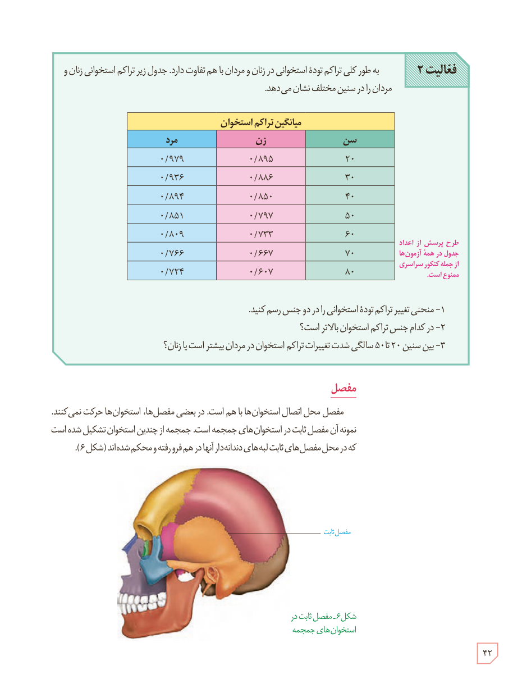

**فعالیت ۲:** به‌طور کلی تراکم تودۀ استخوانی در زنان و مردان با هم تفاوت دارد. جدول زیر تراکم استخوانی زنان و مردان را در سنین مختلف نشان می‌دهد.

| سن | زن | مرد |
|---|---|---|
| ۲۰ | ۰/۸۹۵ | ۰/۹۷۹ |
| ۳۰ | ۰/۸۸۶ | ۰/۹۳۶ |
| ۴۰ | ۰/۸۵۰ | ۰/۸۹۴ |
| ۵۰ | ۰/۷۹۷ | ۰/۸۵۱ |
| ۶۰ | ۰/۷۳۳ | ۰/۸۰۹ |
| ۷۰ | ۰/۶۶۷ | ۰/۷۶۶ |
| ۸۰ | ۰/۶۰۷ | ۰/۷۲۴ |

میانگین تراکم استخوان

طرح پرسش از اعداد جدول در همۀ آزمون‌ها از جمله کنکور سراسری ممنوع است.

۱- منحنی تغییر تراکم تودۀ استخوانی را در دو جنس رسم کنید.  
۲- در کدام جنس تراکم استخوان بالاتر است؟  
۳- بین سنین ۲۰ تا ۵۰ سالگی شدت تغییرات تراکم استخوان در مردان بیشتر است یا زنان؟

## مفصل

مفصل محل اتصال استخوان‌ها با هم است. در بعضی مفصل‌ها، استخوان‌ها حرکت نمی‌کنند. نمونه آن مفصل ثابت در استخوان‌های جمجمه است. جمجمه از چندین استخوان تشکیل شده است که در محل مفصل‌های ثابت، لبه‌های دندانه‌دار آنها در هم فرورفته و محکم شده‌اند (شکل ۶).

شکل ۶ـ مفصل ثابت در استخوان‌های جمجمه

۴۲

