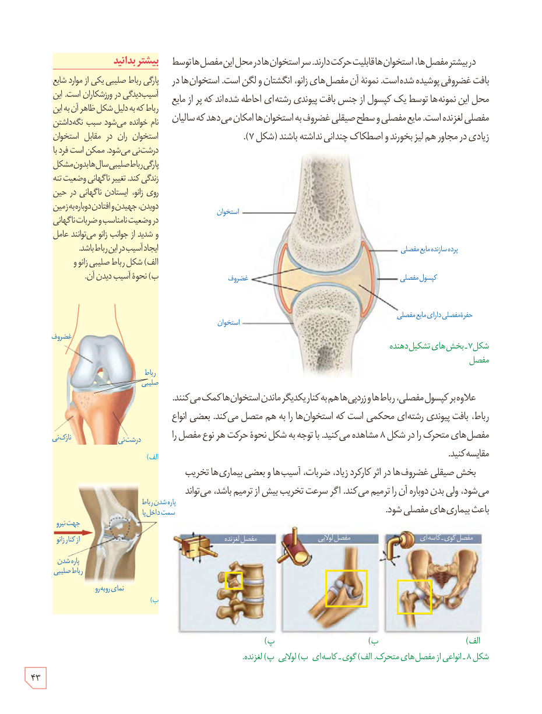

در بیشتر مفصل‌ها، استخوان‌ها قابلیت حرکت دارند. سر استخوان‌ها در محل این مفصل‌ها توسط بافت غضروفی پوشیده شده است. نمونۀ آن مفصل‌های زانو، انگشتان و لگن است. استخوان‌ها در محل این نمونه‌ها توسط یک کپسول از جنس بافت پیوندی رشته‌ای احاطه شده‌اند که پر از مایع مفصلی لغزنده است. مایع مفصلی و سطح صیقلی غضروف به استخوان‌ها امکان می‌دهد که سالیان زیادی در مجاور هم بلغزند و اصطکاک چندانی نداشته باشند (شکل ۷).

علاوه بر کپسول مفصلی، رباط‌ها و زردپی‌ها هم به کنار یکدیگر ماندن استخوان‌ها کمک می‌کنند. رباط، بافت پیوندی رشته‌ای محکمی است که استخوان‌ها را به هم متصل می‌کند. بعضی انواع مفصل‌های متحرک را در شکل ۸ مشاهده می‌کنید. با توجه به شکل نحوۀ حرکت هر نوع مفصل را مقایسه کنید.

بخش صیقلی غضروف‌ها در اثر کارکرد زیاد، ضربات، آسیب‌ها و بعضی بیماری‌ها تخریب می‌شود، ولی بدن دوباره آن را ترمیم می‌کند. اگر سرعت تخریب بیش از ترمیم باشد، می‌تواند باعث بیماری‌های مفصلی شود.

شکل ۷ـ بخش‌های تشکیل‌دهندۀ مفصل  
شکل ۸ـ انواعی از مفصل‌های متحرک: الف) گوی ـ کاسه‌ای، ب) لولایی، پ) لغزنده.

### بیشتر بدانید

پارگی رباط صلیبی یکی از موارد شایع آسیب‌دیدگی در ورزشکاران است. این رباط که به دلیل شکل ظاهر آن به این نام خوانده می‌شود سبب نگه‌داشتن استخوان ران در مقابل استخوان درشت‌نی می‌شود. ممکن است فرد با پارگی رباط صلیبی سال‌ها بدون مشکل زندگی کند. تغییر ناگهانی وضعیت تنه روی زانو، ایستادن ناگهانی در حین دویدن، جهیدن و افتادن دوباره به زمین در وضعیت نامناسب و ضربات ناگهانی و شدید از جوانب زانو می‌توانند عامل ایجاد آسیب در این رباط باشند.

الف) شکل رباط صلیبی زانو و ب) نحوۀ آسیب دیدن آن.

۴۳

