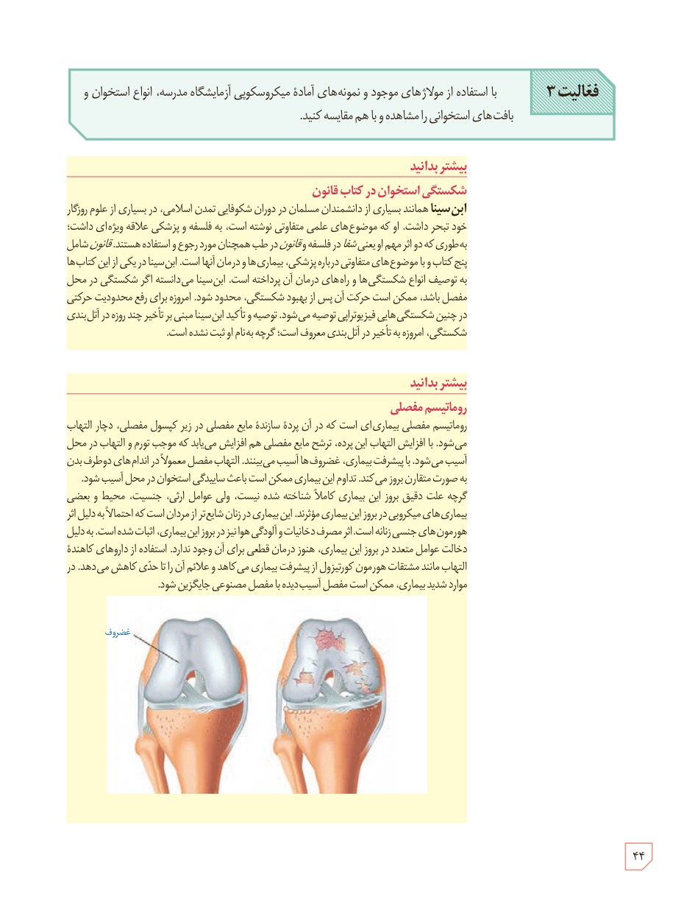

**فعالیت ۳:** با استفاده از مولاژهای موجود و نمونه‌های آماده میکروسکوپی آزمایشگاه مدرسه، انواع استخوان و بافت‌های استخوانی را مشاهده و با هم مقایسه کنید.

### بیشتر بدانید: شکستگی استخوان در کتاب قانون

ابن سینا همانند بسیاری از دانشمندان مسلمان در دوران شکوفایی تمدن اسلامی، در بسیاری از علوم روزگار خود تبحر داشت. او که موضوع‌های علمی متفاوتی نوشته است، به فلسفه و پزشکی علاقه ویژه‌ای داشت؛ به طوری که دو اثر مهم او یعنی شفا در فلسفه و قانون در طب همچنان مورد رجوع و استفاده هستند. قانون شامل پنج کتاب و با موضوع‌های متفاوتی درباره پزشکی، بیماری‌ها و درمان آنهاست. ابن سینا در یکی از این کتاب‌ها به توصیف انواع شکستگی‌ها و راه‌های درمان آن پرداخته است. ابن سینا می‌دانسته اگر شکستگی در محل مفصل باشد، ممکن است حرکت آن پس از بهبود شکستگی، محدود شود. امروزه برای رفع محدودیت حرکتی در چنین شکستگی‌هایی فیزیوتراپی توصیه می‌شود. توصیه و تأکید ابن سینا مبنی بر تأخیر چند روزه در آتل‌بندی شکستگی، امروزه با تأخیر در آتل‌بندی معروف است؛ گرچه به نام او ثبت نشده است.

### بیشتر بدانید: روماتیسم مفصلی

روماتیسم مفصلی بیماری‌ای است که در آن پردۀ سازندۀ مایع مفصلی در زیر کپسول مفصلی، دچار التهاب می‌شود. با افزایش التهاب این پرده، ترشح مایع مفصلی هم افزایش می‌یابد که موجب تورم و التهاب در محل آسیب می‌شود. با پیشرفت بیماری، غضروف‌ها آسیب می‌بینند. التهاب مفصل معمولاً در اندام‌های دو طرف بدن به صورت متقارن بروز می‌کند. تداوم این بیماری ممکن است باعث ساییدگی استخوان در محل آسیب شود. گرچه علت دقیق بروز این بیماری کاملاً شناخته شده نیست، ولی عوامل ارث، جنسیت، محیط و بعضی بیماری‌های میکروبی در بروز این بیماری مؤثرند. این بیماری در زنان شایع‌تر از مردان است که احتمالاً به دلیل اثر هورمون‌های جنسی زنانه است. اثر مصرف دخانیات و آلودگی هوا نیز در بروز این بیماری، اثبات شده است. به دلیل دخالت عوامل متعدد در بروز این بیماری، هنوز درمان قطعی برای آن وجود ندارد. استفاده از داروهای کاهندۀ التهاب مانند مشتقات هورمون کورتیزول از پیشرفت بیماری می‌کاهد و علائم آن را تا حدی کاهش می‌دهد. در موارد شدید بیماری، ممکن است مفصل آسیب‌دیده با مفصل مصنوعی جایگزین شود.

۴۴

