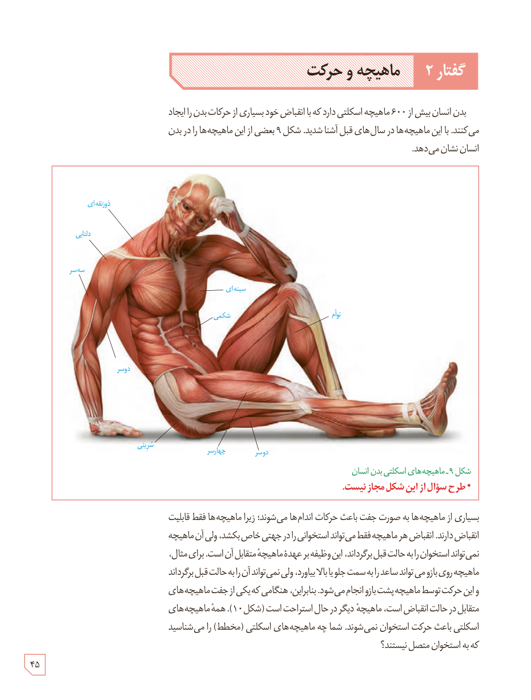

# گفتار ۲: ماهیچه و حرکت

بدن انسان بیش از ۶۰۰ ماهیچۀ اسکلتی دارد که با انقباض خود بسیاری از حرکات بدن را ایجاد می‌کنند. با این ماهیچه‌ها در سال‌های قبل آشنا شدید. شکل ۹ بعضی از این ماهیچه‌ها را در بدن انسان نشان می‌دهد.

شکل ۹ـ ماهیچه‌های اسکلتی بدن انسان. * طرح سؤال از این شکل مجاز نیست.

بسیاری از ماهیچه‌ها به صورت جفت باعث حرکات اندام‌ها می‌شوند؛ زیرا ماهیچه‌ها فقط قابلیت انقباض دارند. انقباض هر ماهیچه فقط می‌تواند استخوانی را در جهتی خاص بکشد، ولی آن ماهیچه نمی‌تواند استخوان را به حالت قبل برگرداند، این وظیفه بر عهدۀ ماهیچۀ متقابل آن است. برای مثال، ماهیچۀ روی بازو می‌تواند ساعد را به سمت جلو یا بالا بیاورد، ولی نمی‌تواند آن را به حالت قبل برگرداند و این حرکت توسط ماهیچۀ پشت بازو انجام می‌شود. بنابراین، هنگامی که یکی از جفت ماهیچه‌های متقابل در حالت انقباض است، ماهیچۀ دیگر در حال استراحت است (شکل ۱۰). همۀ ماهیچه‌های اسکلتی باعث حرکت استخوان نمی‌شوند. شما چه ماهیچه‌های اسکلتی (مخطط) را می‌شناسید که به استخوان متصل نیستند؟

۴۵

