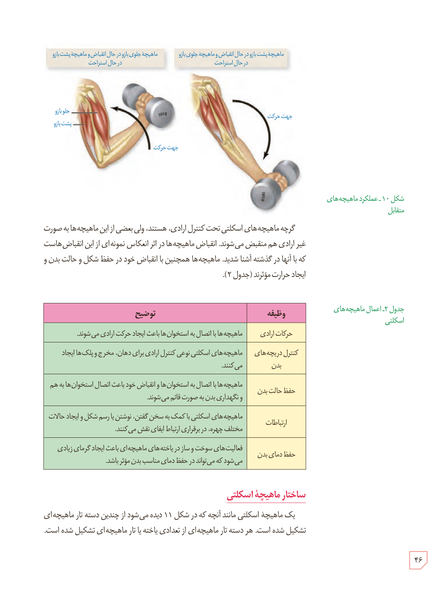

شکل ۱۰ـ عملکرد ماهیچه‌های متقابل

گرچه ماهیچه‌های اسکلتی تحت کنترل ارادی، هستند، ولی بعضی از این ماهیچه‌ها به صورت غیرارادی هم منقبض می‌شوند. انقباض ماهیچه‌ها در اثر انعکاس نمونه‌ای از این انقباض‌هاست که با آنها در گذشته آشنا شدید. ماهیچه‌ها همچنین با انقباض خود در حفظ شکل و حالت بدن و ایجاد حرارت مؤثرند (جدول ۲).

### جدول ۲ـ اعمال ماهیچه‌های اسکلتی

| وظیفه | توضیح |
|---|---|
| حرکات ارادی | ماهیچه‌ها با اتصال به استخوان‌ها باعث ایجاد حرکت ارادی می‌شوند. |
| کنترل دریچه‌های بدن | ماهیچه‌های اسکلتی نوعی کنترل ارادی برای دهان، مخرج و پلک‌ها ایجاد می‌کنند. |
| حفظ حالت بدن | ماهیچه‌ها با اتصال به استخوان‌ها و انقباض خود باعث اتصال استخوان‌ها به هم و نگهداری بدن به صورت قائم می‌شوند. |
| ارتباطات | ماهیچه‌های اسکلتی با کمک به سخن گفتن، نوشتن یا رسم شکل و ایجاد حالات مختلف چهره، در برقراری ارتباط ایفای نقش می‌کنند. |
| حفظ دمای بدن | فعالیت‌های سوخت و ساز در یاخته‌های ماهیچه‌ای باعث ایجاد گرمای زیادی می‌شود که می‌تواند در حفظ دمای مناسب بدن مؤثر باشد. |

## ساختار ماهیچۀ اسکلتی

یک ماهیچۀ اسکلتی مانند آنچه که در شکل ۱۱ دیده می‌شود از چندین دستۀ تار ماهیچه‌ای تشکیل شده است. هر دستۀ تار ماهیچه‌ای از تعدادی یاخته یا تار ماهیچه‌ای تشکیل شده است.

۴۶

