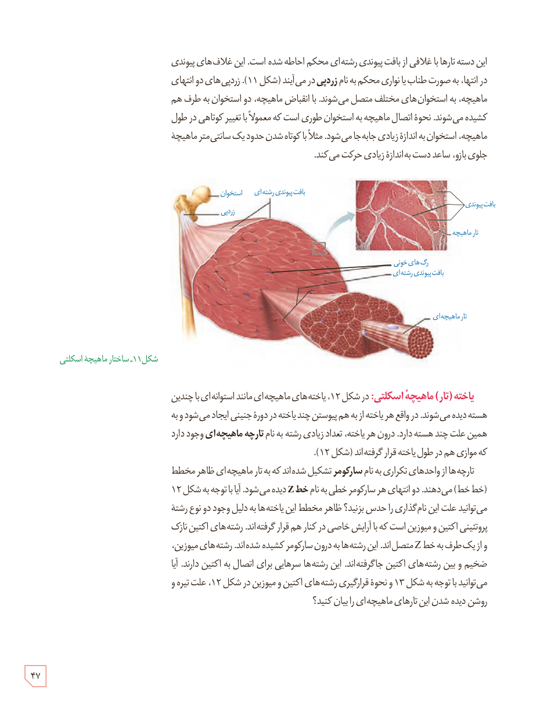

این دسته تارها با غلافی از بافت پیوندی رشته‌ای محکم احاطه شده است. این غلاف‌های پیوندی در انتها، به صورت طناب یا نواری محکم به نام **زردپی** در می‌آیند (شکل ۱۱). زردپی‌های دو انتهای ماهیچه، به استخوان‌های مختلف متصل می‌شوند. با انقباض ماهیچه، دو استخوان به طرف هم کشیده می‌شوند. نحوۀ اتصال ماهیچه به استخوان طوری است که معمولاً با تغییر کوتاهی در طول ماهیچه، استخوان به اندازۀ زیادی جابه‌جا می‌شود. مثلاً با کوتاه شدن حدود یک سانتی‌متر ماهیچۀ جلوی بازو، ساعد دست به اندازۀ زیادی حرکت می‌کند.

شکل ۱۱ـ ساختار ماهیچۀ اسکلتی

**یاخته (تار) ماهیچۀ اسکلتی:** در شکل ۱۲، یاخته‌های ماهیچه‌ای مانند استوانه‌ای با چندین هسته دیده می‌شوند. در واقع هر یاخته از به هم پیوستن چند یاخته در دورۀ جنینی ایجاد می‌شود و به همین علت چند هسته دارد. درون هر یاخته، تعداد زیادی رشته به نام **تارچۀ ماهیچه‌ای** وجود دارد که موازی هم در طول یاخته قرار گرفته‌اند (شکل ۱۲).

تارچه‌ها از واحدهای تکراری به نام **سارکومر** تشکیل شده‌اند که به تار ماهیچه‌ای ظاهر مخطط (خط خط) می‌دهند. دو انتهای هر سارکومر خطی به نام **خط Z** دیده می‌شود. آیا با توجه به شکل ۱۲ می‌توانید علت این نام‌گذاری را حدس بزنید؟ ظاهر مخطط این یاخته‌ها به دلیل وجود دو نوع رشتۀ پروتئینی اکتین و میوزین است که با آرایش خاصی در کنار هم قرار گرفته‌اند. رشته‌های اکتین نازک و از یک طرف به خط Z متصل‌اند. این رشته‌ها به درون سارکومر کشیده شده‌اند. رشته‌های میوزین، ضخیم و بین رشته‌های اکتین جا گرفته‌اند. این رشته‌ها سرهایی برای اتصال به اکتین دارند. آیا می‌توانید با توجه به شکل ۱۳ و نحوۀ قرارگیری رشته‌های اکتین و میوزین در شکل ۱۲، علت تیره و روشن دیده شدن این تارهای ماهیچه‌ای را بیان کنید؟

۴۷

