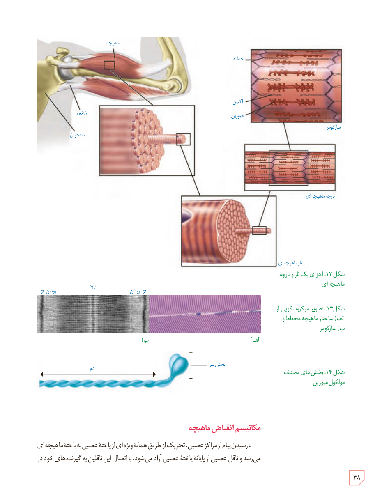

شکل ۱۲ـ اجزای یک تار و تارچۀ ماهیچه‌ای  
شکل ۱۳ـ تصویر میکروسکوپی از الف) ساختار ماهیچۀ مخطط و ب) سارکومر  
شکل ۱۴ـ بخش‌های مختلف مولکول میوزین

## مکانیسم انقباض ماهیچه

با رسیدن پیام از مراکز عصبی، تحریک از طریق همایۀ ویژه‌ای از یاختۀ عصبی به یاختۀ ماهیچه‌ای می‌رسد و ناقل عصبی از پایانۀ یاختۀ عصبی آزاد می‌شود. با اتصال این ناقلین به گیرنده‌های خود در

۴۸

