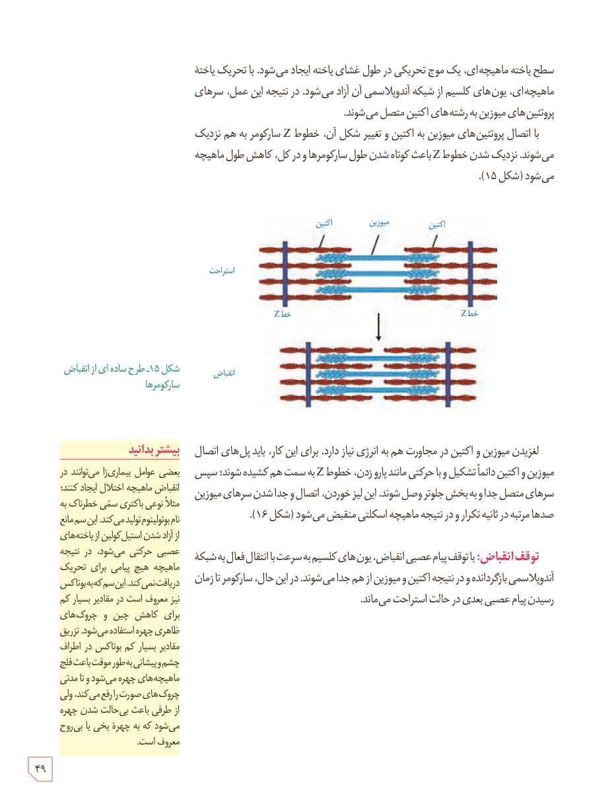

سطح یاختۀ ماهیچه‌ای، یک موج تحریکی در طول غشای یاخته ایجاد می‌شود. با تحریک یاختۀ ماهیچه‌ای، یون‌های کلسیم از شبکۀ آندوپلاسمی آن آزاد می‌شود. در نتیجه این عمل، سرهای پروتئین‌های میوزین به رشته‌های اکتین متصل می‌شوند.

با اتصال پروتئین‌های میوزین به اکتین و تغییر شکل آن، خطوط Z سارکومر به هم نزدیک می‌شوند. نزدیک شدن خطوط Z باعث کوتاه شدن طول سارکومرها و در کل، کاهش طول ماهیچه می‌شود (شکل ۱۵).

شکل ۱۵ـ طرح ساده‌ای از انقباض سارکومرها

لغزیدن میوزین و اکتین در مجاورت هم به انرژی نیاز دارد. برای این کار، باید پل‌های اتصال میوزین و اکتین دائماً تشکیل و با حرکتی مانند پارو زدن، خطوط Z به سمت هم کشیده شوند؛ سپس سرهای متصل جدا و به بخش جلوتر وصل شوند. این لیز خوردن، اتصال و جدا شدن سرهای میوزین صدها مرتبه در ثانیه تکرار و در نتیجه ماهیچۀ اسکلتی منقبض می‌شود (شکل ۱۶).

**توقف انقباض:** با توقف پیام عصبی انقباض، یون‌های کلسیم به سرعت با انتقال فعال به شبکۀ آندوپلاسمی بازگردانده و در نتیجه اکتین و میوزین از هم جدا می‌شوند. در این حال، سارکومر تا زمان رسیدن پیام عصبی بعدی در حالت استراحت می‌ماند.

### بیشتر بدانید

بعضی عوامل بیماری‌زا می‌توانند در انقباض ماهیچه اختلال ایجاد کنند؛ مثلاً نوعی باکتری سمی خطرناک به نام بوتولینوم تولید می‌کند. این سم مانع از آزاد شدن استیل‌کولین از یاخته‌های عصبی حرکتی می‌شود، در نتیجه ماهیچه هیچ پیامی برای تحریک دریافت نمی‌کند. این سم که به بوتاکس نیز معروف است در مقادیر بسیار کم برای کاهش چین و چروک‌های ظاهری چهره استفاده می‌شود. تزریق مقادیر بسیار کم بوتاکس در اطراف چشم و پیشانی به‌طور موقت باعث فلج ماهیچه‌های چهره می‌شود و تا مدتی چروک‌های صورت را رفع می‌کند، ولی از طرفی باعث بی‌حالت شدن چهره می‌شود که به چهرۀ یخی یا بی‌روح معروف است.

۴۹

