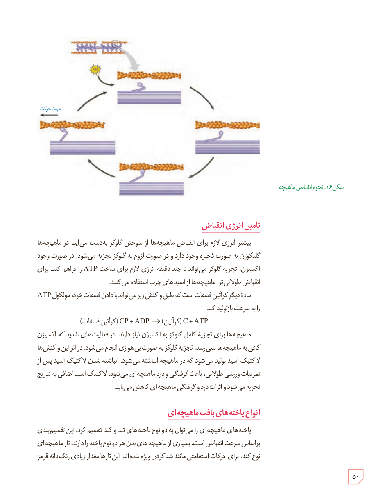

شکل ۱۶ـ نحوۀ انقباض ماهیچه

## تأمین انرژی انقباض

بیشتر انرژی لازم برای انقباض ماهیچه‌ها از سوختن گلوکز به‌دست می‌آید. در ماهیچه‌ها گلیکوژن به صورت ذخیره وجود دارد و در صورت لزوم به گلوکز تجزیه می‌شود. در صورت وجود اکسیژن، تجزیۀ گلوکز می‌تواند تا چند دقیقه انرژی لازم برای ساخت ATP را فراهم کند. برای انقباض طولانی‌تر، ماهیچه‌ها از اسیدهای چرب استفاده می‌کنند.

مادۀ دیگر کراتین فسفات است که طبق واکنش زیر می‌تواند با دادن فسفات خود، مولکول ATP را به سرعت بازتولید کند.

کراتین فسفات (CP) + ADP → کراتین (C) + ATP

ماهیچه‌ها برای تجزیۀ کامل گلوکز به اکسیژن نیاز دارند. در فعالیت‌های شدید که اکسیژن کافی به ماهیچه‌ها نمی‌رسد، تجزیۀ گلوکز به صورت بی‌هوازی انجام می‌شود. در اثر این واکنش‌ها لاکتیک اسید تولید می‌شود که در ماهیچه انباشته می‌شود. انباشته شدن لاکتیک اسید پس از تمرینات ورزشی طولانی، باعث گرفتگی و درد ماهیچه‌ای می‌شود. لاکتیک اسید اضافی به تدریج تجزیه می‌شود و اثرات درد و گرفتگی ماهیچه‌ای کاهش می‌یابد.

## انواع یاخته‌های بافت ماهیچه‌ای

یاخته‌های ماهیچه‌ای را می‌توان به دو نوع یاخته‌های تند و کند تقسیم کرد. این تقسیم‌بندی براساس سرعت انقباض است. بسیاری از ماهیچه‌های بدن هر دو نوع یاخته را دارند. تار ماهیچه‌ای نوع کند، برای حرکات استقامتی مانند شنا کردن ویژه شده‌اند. این تارها مقدار زیادی رنگدانۀ قرمز

۵۰

