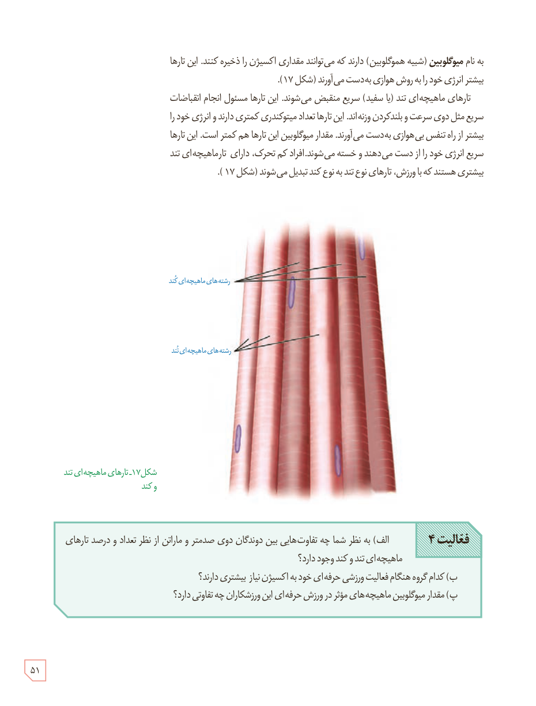

به نام **میوگلوبین** (شبیه هموگلوبین) دارند که می‌توانند مقداری اکسیژن را ذخیره کنند. این تارها بیشتر انرژی خود را به روش هوازی به‌دست می‌آورند (شکل ۱۷).

تارهای ماهیچه‌ای تند (یا سفید) سریع منقبض می‌شوند. این تارها مسئول انجام انقباضات سریع مثل دوی سرعت و بلند کردن وزنه‌اند. این تارها تعداد میتوکندری کمتری دارند و انرژی خود را بیشتر از راه تنفس بی‌هوازی به‌دست می‌آورند. مقدار میوگلوبین این تارها هم کمتر است. این تارها سریع انرژی خود را از دست می‌دهند و خسته می‌شوند. افراد کم‌تحرک، دارای تار ماهیچه‌ای تند بیشتری هستند که با ورزش، تارهای نوع تند به نوع کند تبدیل می‌شوند (شکل ۱۷).

شکل ۱۷ـ تارهای ماهیچه‌ای تند و کند

**فعالیت ۴**

الف) به نظر شما چه تفاوت‌هایی بین دوندگان دوی صدمتر و ماراتن از نظر تعداد و درصد تارهای ماهیچه‌ای تند و کند وجود دارد؟  
ب) کدام گروه هنگام فعالیت ورزشی حرفه‌ای خود به اکسیژن بیشتری نیاز دارند؟  
پ) مقدار میوگلوبین ماهیچه‌های مؤثر در ورزش حرفه‌ای این ورزشکاران چه تفاوتی دارد؟

۵۱

