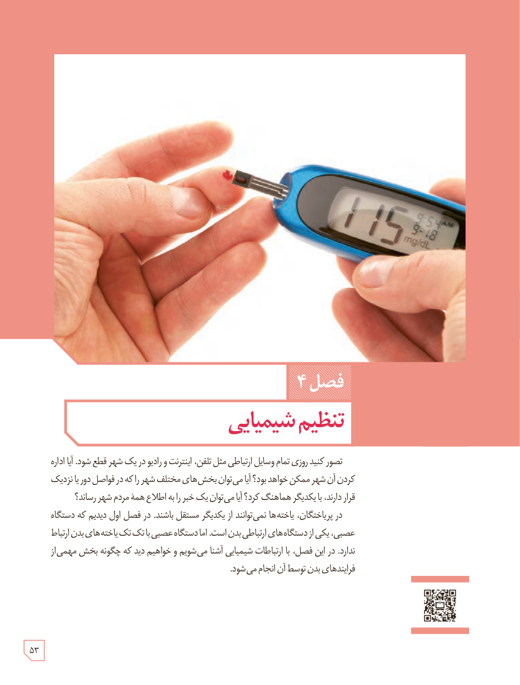

# فصل ۴: تنظیم شیمیایی

تصور کنید روزی تمام وسایل ارتباطی مثل تلفن، اینترنت و رادیو در یک شهر قطع شود. آیا اداره کردن آن شهر ممکن خواهد بود؟ آیا می‌توان بخش‌های مختلف شهر را که در فواصل دور یا نزدیک قرار دارند، با یکدیگر هماهنگ کرد؟ آیا می‌توان یک خبر را به اطلاع همۀ مردم شهر رساند؟

در پریاخته‌ای‌ها، یاخته‌ها نمی‌توانند از یکدیگر مستقل باشند. در فصل اول دیدیم که دستگاه عصبی، یکی از دستگاه‌های ارتباطی بدن است، اما دستگاه عصبی با تک تک یاخته‌های بدن ارتباط ندارد. در این فصل، با ارتباطات شیمیایی آشنا می‌شویم و خواهیم دید که چگونه بخش مهمی از فرایندهای بدن توسط آن انجام می‌شود.

۵۳

