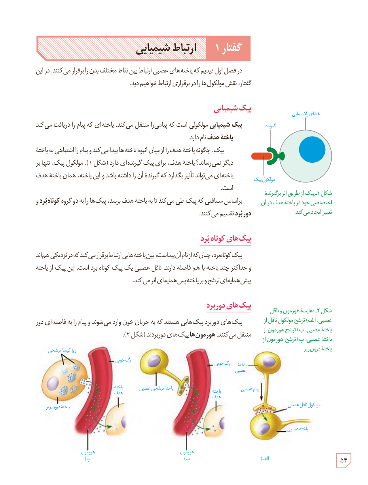

# گفتار ۱: ارتباط شیمیایی

در فصل اول دیدیم که یاخته‌های عصبی ارتباط بین نقاط مختلف بدن را برقرار می‌کنند. در این گفتار، نقش مولکول‌ها را در برقراری ارتباط خواهیم دید.

## پیک شیمیایی

پیک شیمیایی مولکولی است که پیامی را منتقل می‌کند. یاخته‌ای که پیام را دریافت می‌کند، یاختۀ هدف نام دارد.

پیک، چگونه یاختۀ هدف را از میان انبوه یاخته‌ها پیدا می‌کند و پیام را اشتباهی به یاختۀ دیگر نمی‌رساند؟ یاختۀ هدف، برای پیک گیرنده‌ای دارد (شکل ۱). مولکول پیک، تنها بر یاخته‌ای می‌تواند تأثیر بگذارد که گیرندۀ آن را داشته باشد و این یاخته، همان یاختۀ هدف است.

براساس مسافتی که پیک طی می‌کند تا به یاختۀ هدف برسد، پیک‌ها را به دو گروه کوتاه‌بُرد و دوربُرد تقسیم می‌کنند.

شکل ۱ـ پیک از طریق اثر بر گیرندۀ اختصاصی خود در یاختۀ هدف در آن تغییر ایجاد می‌کند. برچسب‌ها: غشای پلاسمایی، گیرنده، مولکول پیک.

## پیک‌های کوتاه‌بُرد

پیک کوتاه‌برد، چنان‌که از نام آن پیداست، بین یاخته‌هایی ارتباط برقرار می‌کند که در نزدیکی هم‌اند و حداکثر چند یاخته با هم فاصله دارند. ناقل عصبی یک پیک کوتاه‌برد است. این پیک از یاختۀ پیش‌همایه‌ای ترشح و بر یاختۀ پس‌همایه‌ای اثر می‌کند.

## پیک‌های دوربرد

پیک‌های دوربرد پیک‌هایی هستند که به جریان خون وارد می‌شوند و پیام را به فاصله‌ای دور منتقل می‌کنند. هورمون‌ها پیک‌های دوربردند (شکل ۲).

شکل ۲ـ مقایسۀ هورمون و ناقل عصبی. الف) ترشح مولکول ناقل از یاختۀ عصبی، ب) ترشح هورمون از یاختۀ عصبی، پ) ترشح هورمون از یاختۀ درون‌ریز. برچسب‌ها: یاختۀ عصبی، پیام عصبی، مولکول ناقل عصبی، یاختۀ هدف، رگ خونی، یاختۀ ترشحی عصبی، هورمون، ریزکیسۀ ترشحی، یاختۀ درون‌ریز.

۵۴

