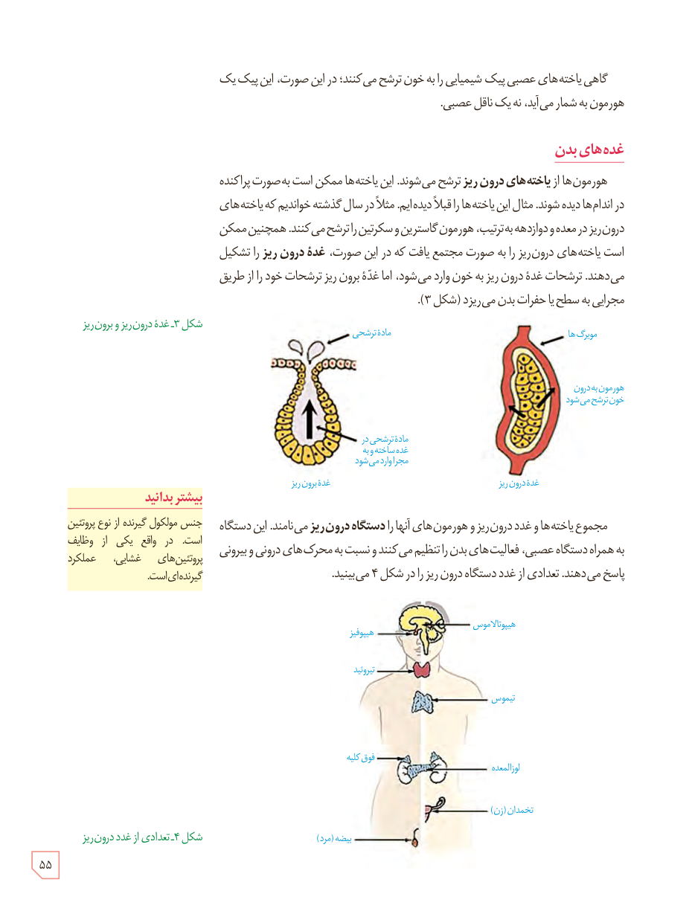

گاهی یاخته‌های عصبی پیک شیمیایی را به خون ترشح می‌کنند؛ در این صورت، این پیک یک هورمون به شمار می‌آید، نه یک ناقل عصبی.

## غده‌های بدن

هورمون‌ها از یاخته‌های درون‌ریز ترشح می‌شوند. این یاخته‌ها ممکن است به صورت پراکنده در اندام‌ها دیده شوند. مثال این یاخته‌ها را قبلاً دیده‌ایم. مثلاً در سال گذشته خواندیم که یاخته‌های درون‌ریز در معده و دوازدهه به ترتیب، هورمون گاسترین و سکرتین را ترشح می‌کنند. همچنین ممکن است یاخته‌های درون‌ریز را به صورت مجتمع یافت که در این صورت، غدۀ درون‌ریز را تشکیل می‌دهند. ترشحات غدۀ درون‌ریز به خون وارد می‌شود، اما غدۀ برون‌ریز ترشحات خود را از طریق مجرایی به سطح یا حفرات بدن می‌ریزد (شکل ۳).

شکل ۳ـ غدۀ درون‌ریز و برون‌ریز. برچسب‌ها: مادۀ ترشحی، مویرگ‌ها، هورمون به درون خون ترشح می‌شود، مادۀ ترشحی در غده ساخته و به مجرا وارد می‌شود، غدۀ برون‌ریز، غدۀ درون‌ریز.

مجموع یاخته‌ها و غدد درون‌ریز و هورمون‌های آنها را دستگاه درون‌ریز می‌نامند. این دستگاه به همراه دستگاه عصبی، فعالیت‌های بدن را تنظیم می‌کنند و نسبت به محرک‌های درونی و بیرونی پاسخ می‌دهند. تعدادی از غدد دستگاه درون‌ریز را در شکل ۴ می‌بینید.

### بیشتر بدانید

جنس مولکول گیرنده از نوع پروتئین است. در واقع یکی از وظایف پروتئین‌های غشایی، عملکرد گیرنده‌ای است.

شکل ۴ـ تعدادی از غدد درون‌ریز. برچسب‌ها: هیپوتالاموس، هیپوفیز، تیروئید، تیموس، فوق کلیه، لوزالمعده، تخمدان (زن)، بیضه (مرد).

۵۵

