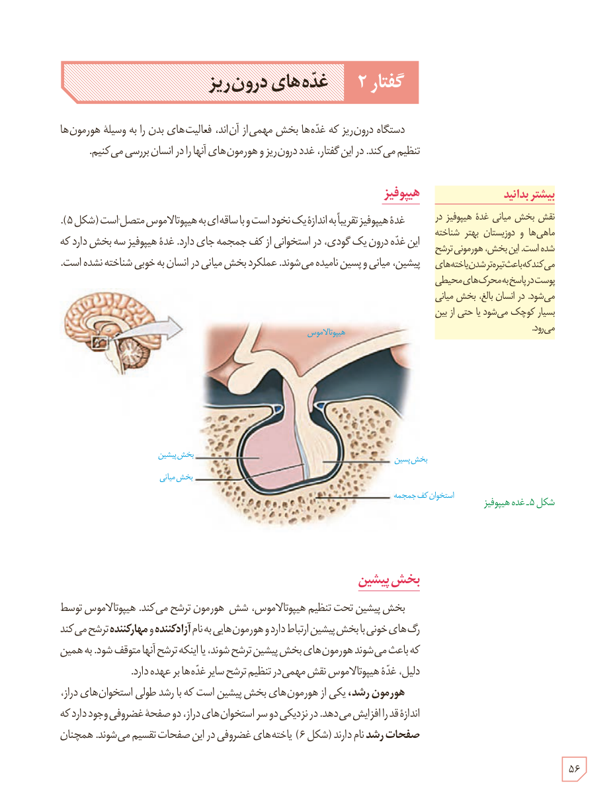

# گفتار ۲: غده‌های درون‌ریز

دستگاه درون‌ریز که غده‌ها بخش مهمی از آن‌اند، فعالیت‌های بدن را به وسیلۀ هورمون‌ها تنظیم می‌کند. در این گفتار، غدد درون‌ریز و هورمون‌های آنها را در انسان بررسی می‌کنیم.

## هیپوفیز

غدۀ هیپوفیز تقریباً به اندازۀ یک نخود است و با ساقه‌ای به هیپوتالاموس متصل است (شکل ۵). این غده درون یک گودی، در استخوانی از کف جمجمه جای دارد. غدۀ هیپوفیز سه بخش دارد که پیشین، میانی و پسین نامیده می‌شوند. عملکرد بخش میانی در انسان به خوبی شناخته نشده است.

### بیشتر بدانید

نقش بخش میانی غدۀ هیپوفیز در ماهی‌ها و دوزیستان بهتر شناخته شده است. این بخش، هورمونی ترشح می‌کند که باعث تیره‌تر شدن یاخته‌های پوست در پاسخ به محرک‌های محیطی می‌شود. در انسان بالغ، بخش میانی بسیار کوچک می‌شود یا حتی از بین می‌رود.

شکل ۵ـ غدۀ هیپوفیز. برچسب‌ها: هیپوتالاموس، بخش پیشین، بخش میانی، بخش پسین، استخوان کف جمجمه.

## بخش پیشین

بخش پیشین تحت تنظیم هیپوتالاموس، شش هورمون ترشح می‌کند. هیپوتالاموس توسط رگ‌های خونی با بخش پیشین ارتباط دارد و هورمون‌هایی به نام آزادکننده و مهارکننده ترشح می‌کند که باعث می‌شوند هورمون‌های بخش پیشین ترشح شوند، یا اینکه ترشح آنها متوقف شود. به همین دلیل، غدۀ هیپوتالاموس نقش مهمی در تنظیم ترشح سایر غده‌ها بر عهده دارد.

هورمون رشد، یکی از هورمون‌های بخش پیشین است که با رشد طولی استخوان‌های دراز، اندازۀ قد را افزایش می‌دهد. در نزدیکی دو سر استخوان‌های دراز، دو صفحه غضروفی وجود دارد که صفحات رشد نام دارند (شکل ۶). یاخته‌های غضروفی در این صفحات تقسیم می‌شوند. همچنان

۵۶

