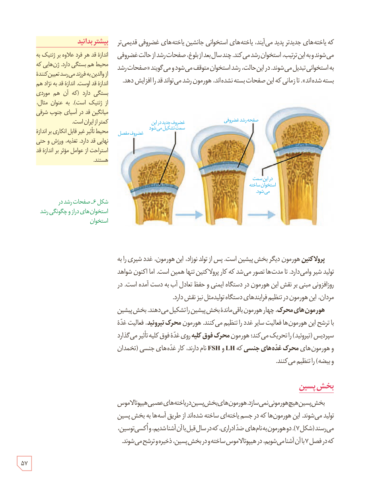

که یاخته‌های جدیدتر پدید می‌آیند، یاخته‌های استخوانی جانشین یاخته‌های غضروفی قدیمی‌تر می‌شوند و به این ترتیب، استخوان رشد می‌کند. چند سال بعد از بلوغ، صفحات رشد از حالت غضروفی به استخوانی تبدیل می‌شوند. در این حالت، رشد استخوان متوقف می‌شود و می‌گویند «صفحات رشد بسته شده‌اند». تا زمانی که این صفحات بسته نشده‌اند، هورمون رشد می‌تواند قد را افزایش دهد.

### بیشتر بدانید

اندازۀ قد هر فرد علاوه بر ژنتیک به محیط هم بستگی دارد. ژن‌هایی که از والدین به فرزند می‌رسند تعیین‌کنندۀ اندازۀ قد اوست. اندازۀ قد به نژاد هم بستگی دارد (که آن هم موردی از ژنتیک است). به عنوان مثال، میانگین قد در آسیای جنوب شرقی کمتر از ایران است.

محیط تأثیر غیر قابل انکاری بر اندازۀ نهایی قد دارد. تغذیه، ورزش و حتی استراحت از عوامل مؤثر بر اندازۀ قد هستند.

شکل ۶ـ صفحات رشد در استخوان‌های دراز و چگونگی رشد استخوان. برچسب‌ها: غضروف مفصل، غضروف جدید در این سمت تشکیل می‌شود، صفحۀ رشد غضروفی، در این سمت استخوان ساخته می‌شود.

پرولاکتین هورمون دیگر بخش پیشین است. پس از تولد نوزاد، این هورمون، غدد شیری را به تولید شیر وا می‌دارد. تا مدت‌ها تصور می‌شد که کار پرولاکتین تنها همین است. اما اکنون شواهد روزافزونی مبنی بر نقش این هورمون در دستگاه ایمنی و حفظ تعادل آب به دست آمده است. در مردان، این هورمون در تنظیم فرایندهای دستگاه تولیدمثل نیز نقش دارد.

هورمون‌های محرک، چهار هورمون باقی‌ماندۀ بخش پیشین را تشکیل می‌دهند. بخش پیشین با ترشح این هورمون‌ها فعالیت سایر غدد را تنظیم می‌کند. هورمون محرک تیروئید، فعالیت غدۀ سپردیس (تیروئید) را تحریک می‌کند؛ هورمون محرک فوق کلیه روی غدۀ فوق کلیه تأثیر می‌گذارد و هورمون‌های محرک غده‌های جنسی که LH و FSH نام دارند، کار غده‌های جنسی (تخمدان و بیضه) را تنظیم می‌کنند.

## بخش پسین

بخش پسین هیچ هورمونی نمی‌سازد. هورمون‌های بخش پسین در یاخته‌های عصبی هیپوتالاموس تولید می‌شوند. این هورمون‌ها که در جسم یاخته‌ای ساخته شده‌اند از طریق آسه‌ها به بخش پسین می‌رسند (شکل ۷). دو هورمون به نام‌های ضد ادراری، که در سال قبل با آن آشنا شدید، و اکسی‌توسین، که در فصل ۷ با آن آشنا می‌شویم، در هیپوتالاموس ساخته و در بخش پسین، ذخیره و ترشح می‌شوند.

۵۷

