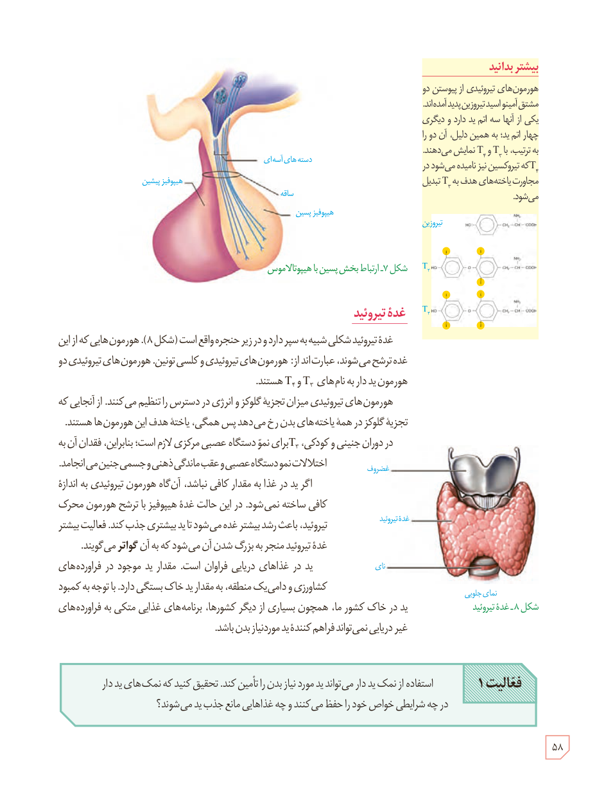

شکل ۷ـ ارتباط بخش پسین با هیپوتالاموس. برچسب‌ها: دسته‌های آسه‌ای، هیپوفیز پیشین، ساقه، هیپوفیز پسین.

### بیشتر بدانید

هورمون‌های تیروئیدی از پیوستن دو مشتق آمینواسید تیروزین پدید آمده‌اند. یکی از آنها سه اتم ید دارد و دیگری چهار اتم ید؛ به همین دلیل، آن دو را به ترتیب، با T₃ و T₄ نمایش می‌دهند. T₄ که تیروکسین نیز نامیده می‌شود در مجاورت یاخته‌های هدف به T₃ تبدیل می‌شود.

## غدۀ تیروئید

غدۀ تیروئید شکلی شبیه به سپر دارد و در زیر حنجره واقع است (شکل ۸). هورمون‌هایی که از این غده ترشح می‌شوند، عبارت‌اند از: هورمون‌های تیروئیدی و کلسی‌تونین. هورمون‌های تیروئیدی دو هورمون یددار به نام‌های T₃ و T₄ هستند.

هورمون‌های تیروئیدی میزان تجزیۀ گلوکز و انرژی در دسترس را تنظیم می‌کنند. از آنجایی که تجزیۀ گلوکز در همۀ یاخته‌های بدن رخ می‌دهد پس همگی، یاختۀ هدف این هورمون‌ها هستند. در دوران جنینی و کودکی، T₃ برای نمو دستگاه عصبی مرکزی لازم است؛ بنابراین، فقدان آن به اختلالات نمو دستگاه عصبی و عقب‌ماندگی ذهنی و جسمی جنین می‌انجامد.

اگر ید در غذا به مقدار کافی نباشد، آن‌گاه هورمون تیروئیدی به اندازۀ کافی ساخته نمی‌شود. در این حالت غدۀ هیپوفیز با ترشح هورمون محرک تیروئید، باعث رشد بیشتر غده می‌شود تا ید بیشتری جذب کند. فعالیت بیشتر غدۀ تیروئید منجر به بزرگ شدن آن می‌شود که به آن گواتر می‌گویند.

ید در غذاهای دریایی فراوان است. مقدار ید موجود در فرآورده‌های کشاورزی و دامی یک منطقه، به مقدار ید خاک بستگی دارد. با توجه به کمبود ید در خاک کشور ما، همچون بسیاری از دیگر کشورها، برنامه‌های غذایی متکی به فرآورده‌های غیر دریایی نمی‌تواند فراهم‌کنندۀ ید مورد نیاز بدن باشد.

شکل ۸ـ غدۀ تیروئید. برچسب‌ها: غضروف، غدۀ تیروئید، نای، نمای جلویی.

**فعالیت ۱:** استفاده از نمک یددار می‌تواند ید مورد نیاز بدن را تأمین کند. تحقیق کنید که نمک‌های یددار در چه شرایطی خواص خود را حفظ می‌کنند و چه غذاهایی مانع جذب ید می‌شوند؟

۵۸

