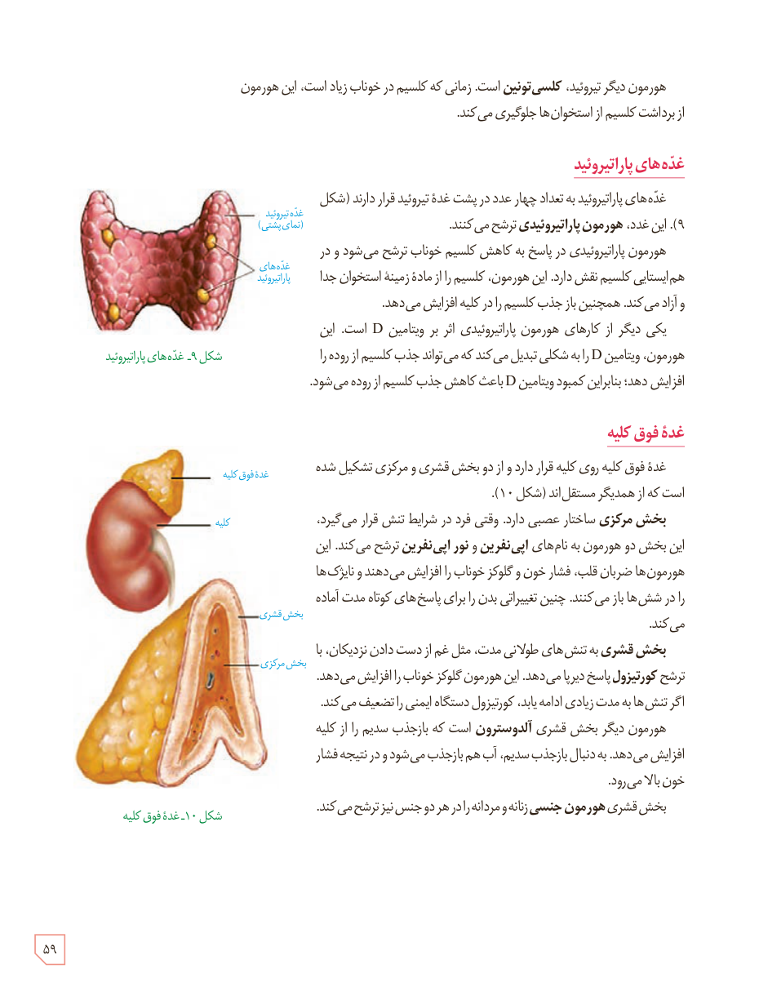

هورمون دیگر تیروئید، کلسی‌تونین است. زمانی که کلسیم در خوناب زیاد است، این هورمون از برداشت کلسیم از استخوان‌ها جلوگیری می‌کند.

## غده‌های پاراتیروئید

غده‌های پاراتیروئید به تعداد چهار عدد در پشت غدۀ تیروئید قرار دارند (شکل ۹). این غدد، هورمون پاراتیروئیدی ترشح می‌کنند.

هورمون پاراتیروئیدی در پاسخ به کاهش کلسیم خوناب ترشح می‌شود و در هم‌ایستایی کلسیم نقش دارد. این هورمون، کلسیم را از مادۀ زمینۀ استخوان جدا و آزاد می‌کند. همچنین بازجذب کلسیم را در کلیه افزایش می‌دهد.

یکی دیگر از کارهای هورمون پاراتیروئیدی اثر بر ویتامین D است. این هورمون، ویتامین D را به شکلی تبدیل می‌کند که می‌تواند جذب کلسیم از روده را افزایش دهد؛ بنابراین کمبود ویتامین D باعث کاهش جذب کلسیم از روده می‌شود.

شکل ۹ـ غده‌های پاراتیروئید. برچسب‌ها: غدۀ تیروئید (نمای پشتی)، غده‌های پاراتیروئید.

## غدۀ فوق کلیه

غدۀ فوق کلیه روی کلیه قرار دارد و از دو بخش قشری و مرکزی تشکیل شده است که از همدیگر مستقل‌اند (شکل ۱۰).

بخش مرکزی ساختار عصبی دارد. وقتی فرد در شرایط تنش قرار می‌گیرد، این بخش دو هورمون به نام‌های اپی‌نفرین و نوراپی‌نفرین ترشح می‌کند. این هورمون‌ها ضربان قلب، فشار خون و گلوکز خوناب را افزایش می‌دهند و نایژک‌ها را در شش‌ها باز می‌کنند. چنین تغییراتی بدن را برای پاسخ‌های کوتاه مدت آماده می‌کند.

بخش قشری به تنش‌های طولانی مدت، مثل غم از دست دادن نزدیکان، با ترشح کورتیزول پاسخ دیرپا می‌دهد. این هورمون گلوکز خوناب را افزایش می‌دهد. اگر تنش‌ها به مدت زیادی ادامه یابد، کورتیزول دستگاه ایمنی را تضعیف می‌کند.

هورمون دیگر بخش قشری آلدوسترون است که بازجذب سدیم را از کلیه افزایش می‌دهد. به دنبال بازجذب سدیم، آب هم بازجذب می‌شود و در نتیجه فشار خون بالا می‌رود.

بخش قشری هورمون جنسی زنانه و مردانه را در هر دو جنس نیز ترشح می‌کند.

شکل ۱۰ـ غدۀ فوق کلیه. برچسب‌ها: غدۀ فوق کلیه، کلیه، بخش قشری، بخش مرکزی.

۵۹

