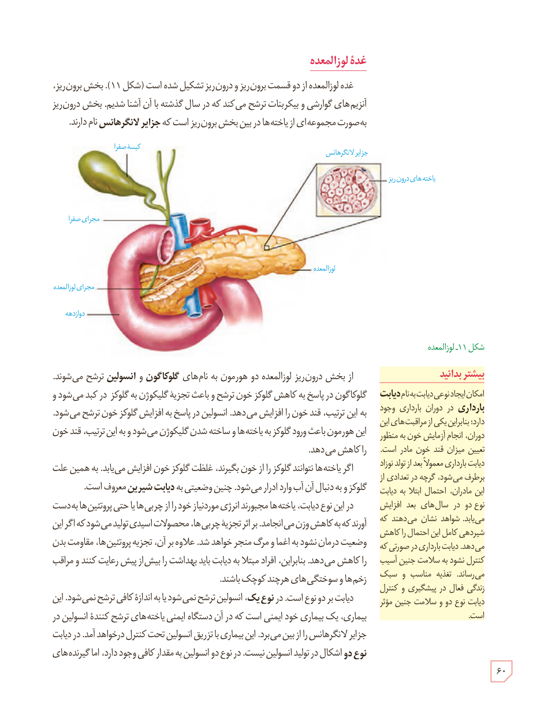

## غدۀ لوزالمعده

غدۀ لوزالمعده از دو قسمت برون‌ریز و درون‌ریز تشکیل شده است (شکل ۱۱). بخش برون‌ریز، آنزیم‌های گوارشی و بی‌کربنات ترشح می‌کند که در سال گذشته با آن آشنا شدید. بخش درون‌ریز به صورت مجموعه‌ای از یاخته‌ها در بین بخش برون‌ریز است که جزایر لانگرهانس نام دارند.

شکل ۱۱ـ لوزالمعده. برچسب‌ها: کیسۀ صفرا، مجرای صفرا، مجرای لوزالمعده، دوازدهه، جزایر لانگرهانس، یاخته‌های درون‌ریز، لوزالمعده.

از بخش درون‌ریز لوزالمعده دو هورمون به نام‌های گلوکاگون و انسولین ترشح می‌شوند. گلوکاگون در پاسخ به کاهش گلوکز خون ترشح و باعث تجزیۀ گلیکوژن به گلوکز در کبد می‌شود و به این ترتیب، قند خون را افزایش می‌دهد. انسولین در پاسخ به افزایش گلوکز خون ترشح می‌شود. این هورمون باعث ورود گلوکز به یاخته‌ها و ساخته شدن گلیکوژن می‌شود و به این ترتیب، قند خون را کاهش می‌دهد.

اگر یاخته‌ها نتوانند گلوکز را از خون بگیرند، غلظت گلوکز خون افزایش می‌یابد. به همین علت گلوکز و به دنبال آن آب وارد ادرار می‌شود. چنین وضعیتی به دیابت شیرین معروف است.

در این نوع دیابت، یاخته‌ها مجبورند انرژی مورد نیاز خود را از چربی‌ها یا حتی پروتئین‌ها به دست آورند که به کاهش وزن می‌انجامد. بر اثر تجزیۀ چربی‌ها، محصولات اسیدی تولید می‌شود که اگر این وضعیت درمان نشود به اغما و مرگ منجر خواهد شد. علاوه بر آن، تجزیۀ پروتئین‌ها، مقاومت بدن را کاهش می‌دهد. بنابراین، افراد مبتلا به دیابت باید بهداشت را بیش از پیش رعایت کنند و مراقب زخم‌ها و سوختگی‌های هرچند کوچک باشند.

دیابت بر دو نوع است. در نوع یک، انسولین ترشح نمی‌شود یا به اندازۀ کافی ترشح نمی‌شود. این بیماری، یک بیماری خودایمنی است که در آن دستگاه ایمنی یاخته‌های ترشح‌کنندۀ انسولین در جزایر لانگرهانس را از بین می‌برد. این بیماری با تزریق انسولین تحت کنترل درخواهد آمد. در دیابت نوع دو اشکال در تولید انسولین نیست. در نوع دو انسولین به مقدار کافی وجود دارد، اما گیرنده‌های

### بیشتر بدانید

امکان ایجاد نوعی دیابت به نام دیابت بارداری در دوران بارداری وجود دارد؛ بنابراین یکی از مراقبت‌های این دوران، انجام آزمایش خون به منظور تعیین میزان قند خون مادر است. دیابت بارداری معمولاً بعد از تولد نوزاد برطرف می‌شود، گرچه در تعدادی از این مادران، احتمال ابتلا به دیابت نوع دو در سال‌های بعد افزایش می‌یابد. شواهد نشان می‌دهند که شیردهی کامل این احتمال را کاهش می‌دهد. دیابت بارداری در صورتی که کنترل نشود به سلامت جنین آسیب می‌رساند. تغذیۀ مناسب و سبک زندگی فعال در پیشگیری و کنترل دیابت نوع دو و سلامت جنین مؤثر است.

۶۰

