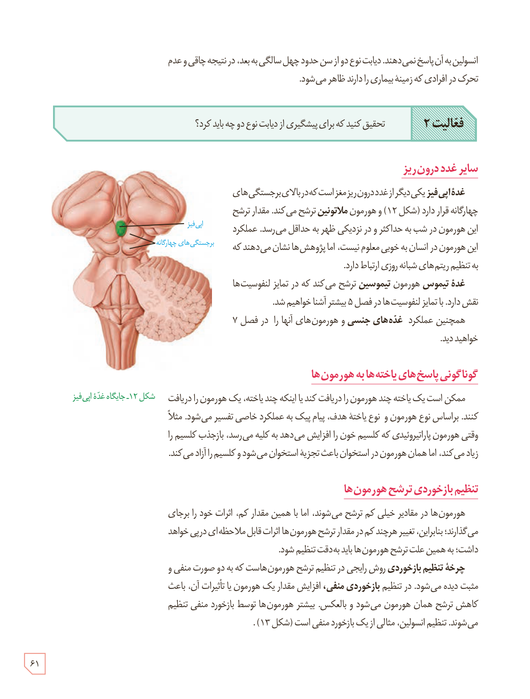

انسولین به آن پاسخ نمی‌دهند. دیابت نوع دو از سن حدود چهل سالگی به بعد، در نتیجۀ چاقی و عدم تحرک در افرادی که زمینۀ بیماری را دارند ظاهر می‌شود.

**فعالیت ۲:** تحقیق کنید که برای پیشگیری از دیابت نوع دو چه باید کرد؟

## سایر غدد درون‌ریز

غدۀ اپی‌فیز یکی دیگر از غدد درون‌ریز مغز است که در بالای برجستگی‌های چهارگانه قرار دارد (شکل ۱۲) و هورمون ملاتونین ترشح می‌کند. مقدار ترشح این هورمون در شب به حداکثر و در نزدیکی ظهر به حداقل می‌رسد. عملکرد این هورمون در انسان به خوبی معلوم نیست، اما پژوهش‌ها نشان می‌دهند که به تنظیم ریتم‌های شبانه‌روزی ارتباط دارد.

غدۀ تیموس هورمون تیموسین ترشح می‌کند که در تمایز لنفوسیت‌ها نقش دارد. با تمایز لنفوسیت‌ها در فصل ۵ بیشتر آشنا خواهیم شد.

همچنین عملکرد غده‌های جنسی و هورمون‌های آنها را در فصل ۷ خواهید دید.

شکل ۱۲ـ جایگاه غدۀ اپی‌فیز. برچسب‌ها: اپی‌فیز، برجستگی‌های چهارگانه.

## گوناگونی پاسخ‌های یاخته‌ها به هورمون‌ها

ممکن است یک یاخته چند هورمون را دریافت کند یا اینکه چند یاخته، یک هورمون را دریافت کنند. براساس نوع هورمون و نوع یاختۀ هدف، پیام پیک به عملکرد خاصی تفسیر می‌شود. مثلاً وقتی هورمون پاراتیروئیدی که کلسیم خون را افزایش می‌دهد به کلیه می‌رسد، بازجذب کلسیم را زیاد می‌کند، اما همان هورمون در استخوان باعث تجزیۀ استخوان می‌شود و کلسیم را آزاد می‌کند.

## تنظیم بازخوردی ترشح هورمون‌ها

هورمون‌ها در مقادیر خیلی کم ترشح می‌شوند، اما با همین مقدار کم، اثرات خود را بر جای می‌گذارند؛ بنابراین، تغییر هرچند کم در مقدار ترشح هورمون‌ها اثرات قابل ملاحظه‌ای در پی خواهد داشت؛ به همین علت ترشح هورمون‌ها باید به دقت تنظیم شود.

چرخۀ تنظیم بازخوردی روش رایجی در تنظیم ترشح هورمون‌هاست که به دو صورت منفی و مثبت دیده می‌شود. در تنظیم بازخوردی منفی، افزایش مقدار یک هورمون یا تأثیرات آن، باعث کاهش ترشح همان هورمون می‌شود و بالعکس. بیشتر هورمون‌ها توسط بازخورد منفی تنظیم می‌شوند. تنظیم انسولین، مثالی از یک بازخورد منفی است (شکل ۱۳).

۶۱

