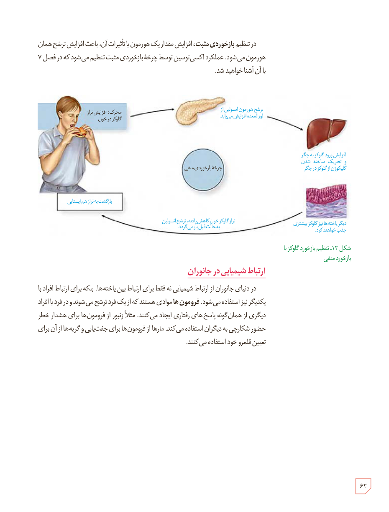

در تنظیم بازخوردی مثبت، افزایش مقدار یک هورمون یا تأثیرات آن، باعث افزایش ترشح همان هورمون می‌شود. عملکرد اکسی‌توسین توسط چرخۀ بازخوردی مثبت تنظیم می‌شود که در فصل ۷ با آن آشنا خواهید شد.

شکل ۱۳ـ تنظیم بازخورد گلوکز با بازخورد منفی. برچسب‌ها: محرک: افزایش تراز گلوکز در خون؛ ترشح هورمون انسولین از لوزالمعده افزایش می‌یابد؛ افزایش ورود گلوکز به جگر و تحریک ساخته شدن گلیکوژن از گلوکز در جگر؛ دیگر یاخته‌ها نیز گلوکز بیشتری جذب خواهند کرد؛ تراز گلوکز خون کاهش یافته، ترشح انسولین به حالت قبل باز می‌گردد؛ بازگشت به تراز هم‌ایستایی؛ چرخۀ بازخوردی منفی.

## ارتباط شیمیایی در جانوران

در دنیای جانوران از ارتباط شیمیایی نه فقط برای ارتباط بین یاخته‌ها، بلکه برای ارتباط افراد با یکدیگر نیز استفاده می‌شود. فرومون‌ها موادی هستند که از یک فرد ترشح می‌شوند و در فرد یا افراد دیگری از همان گونه پاسخ‌های رفتاری ایجاد می‌کنند. مثلاً زنبور از فرومون‌ها برای هشدار خطر حضور شکارچی به دیگران استفاده می‌کند. مارها از فرومون‌ها برای جفت‌یابی و گربه‌ها از آن برای تعیین قلمرو خود استفاده می‌کنند.

۶۲

