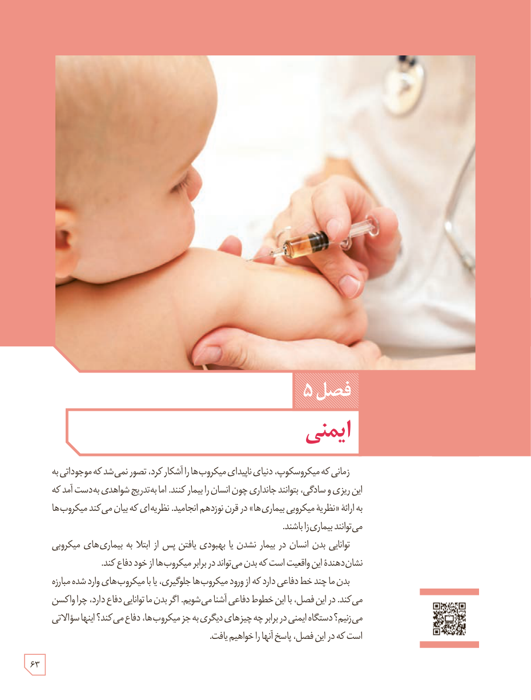

# فصل ۵: ایمنی

زمانی که میکروسکوپ، دنیای ناپیدای میکروب‌ها را آشکار کرد، تصور نمی‌شد که موجوداتی به این ریزی و سادگی، بتوانند جانداری چون انسان را بیمار کنند. اما به تدریج شواهدی به‌دست آمد که به ارائۀ «نظریۀ میکروبی بیماری‌ها» در قرن نوزدهم انجامید. نظریه‌ای که بیان می‌کند میکروب‌ها می‌توانند بیماری‌زا باشند.

توانایی بدن انسان در بیمار نشدن یا بهبودی یافتن پس از ابتلا به بیماری‌های میکروبی نشان‌دهندۀ این واقعیت است که بدن می‌تواند در برابر میکروب‌ها از خود دفاع کند.

بدن ما چند خط دفاعی دارد که از ورود میکروب‌ها جلوگیری، یا با میکروب‌های وارد شده مبارزه می‌کنند. در این فصل، با این خطوط دفاعی آشنا می‌شویم. اگر بدن ما توانایی دفاع دارد، چرا واکسن می‌زنیم؟ دستگاه ایمنی در برابر چه چیزهای دیگری به جز میکروب‌ها، دفاع می‌کند؟ اینها سؤالاتی است که در این فصل، پاسخ آنها را خواهیم یافت.

۶۳

