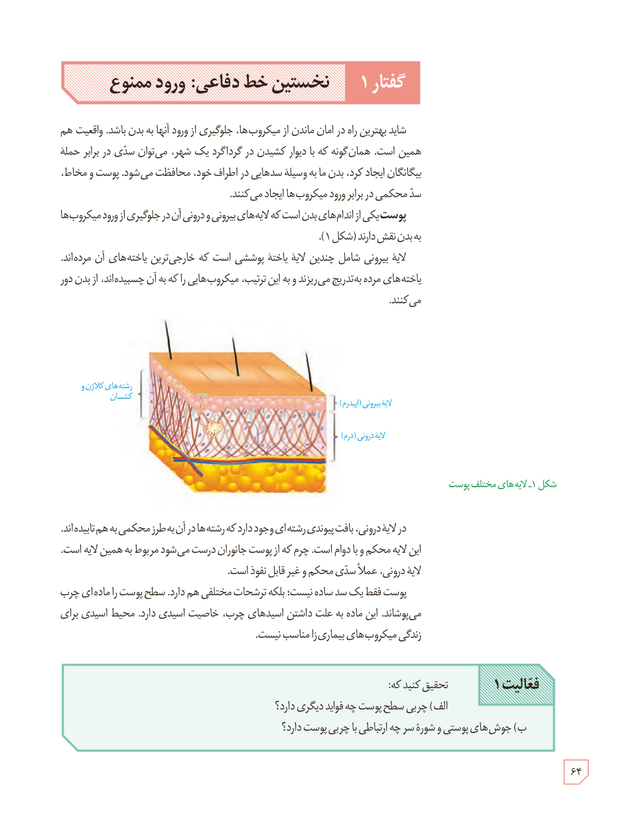

# گفتار ۱: نخستین خط دفاعی: ورود ممنوع

شاید بهترین راه در امان ماندن از میکروب‌ها، جلوگیری از ورود آنها به بدن باشد. واقعیت هم همین است. همان‌گونه که با دیوار کشیدن در گرداگرد یک شهر، می‌توان سدی در برابر حملۀ بیگانگان ایجاد کرد، بدن ما به وسیلۀ سدهایی در اطراف خود، محافظت می‌شود. پوست و مخاط، سد محکمی در برابر ورود میکروب‌ها ایجاد می‌کنند.

پوست یکی از اندام‌های بدن است که لایه‌های بیرونی و درونی آن در جلوگیری از ورود میکروب‌ها به بدن نقش دارند (شکل ۱).

لایۀ بیرونی شامل چندین لایۀ یاختۀ پوششی است که خارجی‌ترین یاخته‌های آن مرده‌اند. یاخته‌های مرده به‌تدریج می‌ریزند و به این ترتیب، میکروب‌هایی را که به آن چسبیده‌اند، از بدن دور می‌کنند.

شکل ۱ـ لایه‌های مختلف پوست. برچسب‌ها: رشته‌های کلاژن و کشسان، لایۀ بیرونی (اپیدرم)، لایۀ درونی (درم).

در لایۀ درونی، بافت پیوندی رشته‌ای وجود دارد که رشته‌ها در آن به طرز محکمی به هم تنیده‌اند. این لایه محکم و با دوام است. چرم که از پوست جانوران درست می‌شود مربوط به همین لایه است. لایۀ درونی، عملاً سدی محکم و غیر قابل نفوذ است.

پوست فقط یک سد ساده نیست؛ بلکه ترشحات مختلفی هم دارد. سطح پوست را ماده‌ای چرب می‌پوشاند. این ماده به علت داشتن اسیدهای چرب، خاصیت اسیدی دارد. محیط اسیدی برای زندگی میکروب‌های بیماری‌زا مناسب نیست.

**فعالیت ۱:** تحقیق کنید که:  
الف) چربی سطح پوست چه فواید دیگری دارد؟  
ب) جوش‌های پوستی و شورۀ سر چه ارتباطی با چربی پوست دارد؟

۶۴

