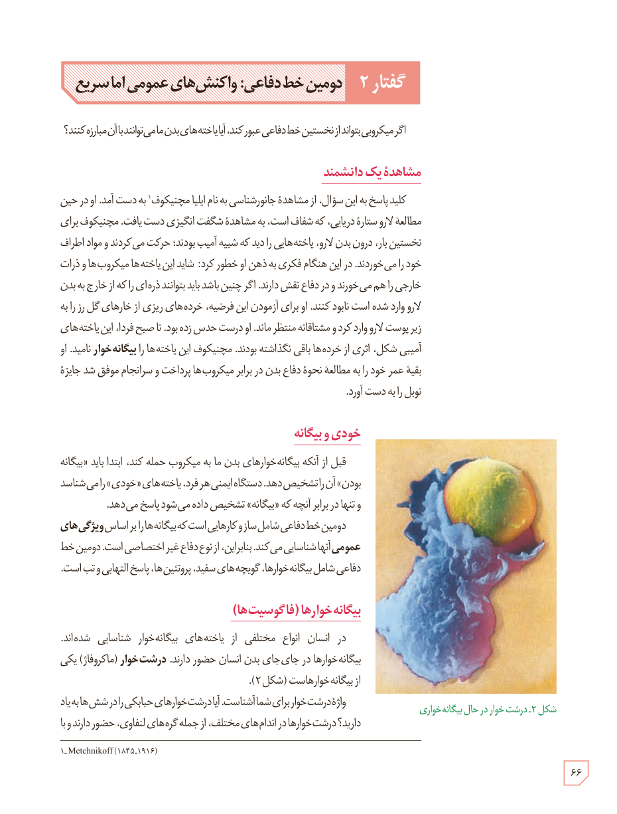

# گفتار ۲: دومین خط دفاعی: واکنش‌های عمومی اما سریع

اگر میکروبی بتواند از نخستین خط دفاعی عبور کند، آیا یاخته‌های بدن ما می‌توانند با آن مبارزه کنند؟

## مشاهدۀ یک دانشمند

کلید پاسخ به این سؤال، از مشاهدۀ جانورشناسی به نام ایلیا مچنیکوف¹ به دست آمد. او در حین مطالعۀ لارو ستارۀ دریایی، که شفاف است، به مشاهدۀ شگفت‌انگیزی دست یافت. مچنیکوف برای نخستین بار، درون بدن لارو، یاخته‌هایی را دید که شبیه آمیب بودند؛ حرکت می‌کردند و مواد اطراف خود را می‌خوردند. در این هنگام فکری به ذهن او خطور کرد: شاید این یاخته‌ها میکروب‌ها و ذرات خارجی را هم می‌خورند و در دفاع نقش دارند. اگر چنین باشد باید بتوانند ذره‌ای را که از خارج به بدن لارو وارد شده است نابود کنند. او برای آزمودن این فرضیه، خرده‌های ریزی از خارهای گل رز را به زیر پوست لارو وارد کرد و مشتاقانه منتظر ماند. او درست حدس زده بود. تا صبح فردا، این یاخته‌های آمیبی شکل، اثری از خرده‌ها باقی نگذاشته بودند. مچنیکوف این یاخته‌ها را بیگانه‌خوار نامید. او بقیۀ عمر خود را به مطالعۀ نحوۀ دفاع بدن در برابر میکروب‌ها پرداخت و سرانجام موفق شد جایزۀ نوبل را به دست آورد.

## خودی و بیگانه

قبل از آنکه بیگانه‌خوارهای بدن ما به میکروب حمله کنند، ابتدا باید «بیگانه بودن» آن را تشخیص دهند. دستگاه ایمنی هر فرد، یاخته‌های «خودی» را می‌شناسد و تنها در برابر آنچه که «بیگانه» تشخیص داده می‌شود پاسخ می‌دهد.

دومین خط دفاعی شامل سازوکارهایی است که بیگانه‌ها را براساس ویژگی‌های عمومی آنها شناسایی می‌کند. بنابراین، از نوع دفاع غیر اختصاصی است. دومین خط دفاعی شامل بیگانه‌خوارها، گویچه‌های سفید، پروتئین‌ها، پاسخ التهابی و تب است.

## بیگانه‌خوارها (فاگوسیت‌ها)

در انسان انواع مختلفی از یاخته‌های بیگانه‌خوار شناسایی شده‌اند. بیگانه‌خوارها در جای‌جای بدن انسان حضور دارند. درشت‌خوار (ماکروفاژ) یکی از بیگانه‌خوارهاست (شکل ۲).

واژۀ درشت‌خوار برای شما آشناست. آیا درشت‌خوارهای حبابک را در شش‌ها به یاد دارید؟ درشت‌خوارها در اندام‌های مختلف، از جمله گره‌های لنفاوی، حضور دارند و با

شکل ۲ـ درشت‌خوار در حال بیگانه‌خواری

۱ـ Metchnikoff (۱۸۴۵-۱۹۱۶)

۶۶

