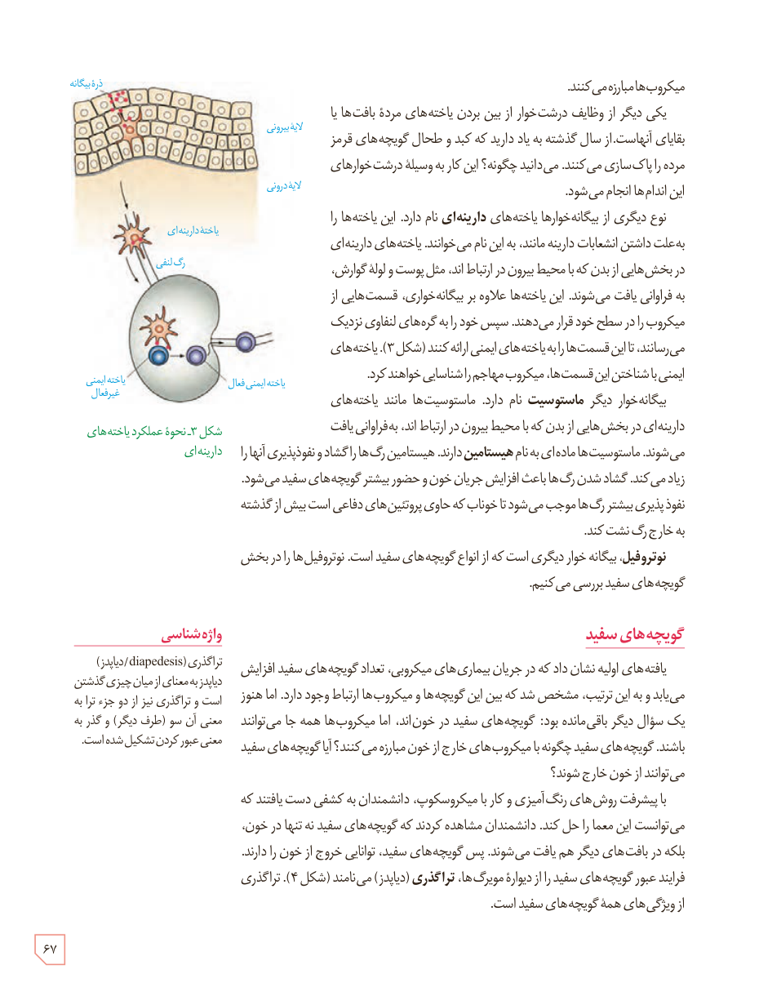

میکروب‌ها مبارزه می‌کنند.

یکی دیگر از وظایف درشت‌خوار از بین بردن یاخته‌های مردۀ بافت‌ها یا بقایای آنهاست. از سال گذشته به یاد دارید که کبد و طحال گویچه‌های قرمز مرده را پاک‌سازی می‌کنند. می‌دانید چگونه؟ این کار به وسیلۀ درشت‌خوارهای این اندام‌ها انجام می‌شود.

نوع دیگری از بیگانه‌خوارها یاخته‌های دارینه‌ای نام دارد. این یاخته‌ها را به‌علت داشتن انشعابات دارینه‌مانند، به این نام می‌خوانند. یاخته‌های دارینه‌ای در بخش‌هایی از بدن که با محیط بیرون در ارتباط‌اند، مثل پوست و لولۀ گوارش، به فراوانی یافت می‌شوند. این یاخته‌ها علاوه بر بیگانه‌خواری، قسمت‌هایی از میکروب را در سطح خود قرار می‌دهند. سپس خود را به گره‌های لنفاوی نزدیک می‌رسانند، تا این قسمت‌ها را به یاخته‌های ایمنی ارائه کنند (شکل ۳). یاخته‌های ایمنی با شناختن این قسمت‌ها، میکروب مهاجم را شناسایی خواهند کرد.

بیگانه‌خوار دیگر ماستوسیت نام دارد. ماستوسیت‌ها مانند یاخته‌های دارینه‌ای در بخش‌هایی از بدن که با محیط بیرون در ارتباط‌اند، به فراوانی یافت می‌شوند. ماستوسیت‌ها ماده‌ای به نام هیستامین دارند. هیستامین رگ‌ها را گشاد و نفوذپذیری آنها را زیاد می‌کند. گشاد شدن رگ‌ها باعث افزایش جریان خون و حضور بیشتر گویچه‌های سفید می‌شود. نفوذپذیری بیشتر رگ‌ها موجب می‌شود تا خوناب که حاوی پروتئین‌های دفاعی است بیش از گذشته به خارج رگ نشت کند.

نوتروفیل، بیگانه‌خوار دیگری است که از انواع گویچه‌های سفید است. نوتروفیل‌ها را در بخش گویچه‌های سفید بررسی می‌کنیم.

شکل ۳ـ نحوۀ عملکرد یاخته‌های دارینه‌ای. برچسب‌ها: ذرۀ بیگانه، لایۀ بیرونی، لایۀ درونی، یاختۀ دارینه‌ای، رگ لنفی، یاختۀ ایمنی غیرفعال، یاختۀ ایمنی فعال.

## گویچه‌های سفید

یافته‌های اولیه نشان داد که در جریان بیماری‌های میکروبی، تعداد گویچه‌های سفید افزایش می‌یابد و به این ترتیب، مشخص شد که بین این گویچه‌ها و میکروب‌ها ارتباط وجود دارد. اما هنوز یک سؤال دیگر باقی‌مانده بود: گویچه‌های سفید در خون‌اند، اما میکروب‌ها همه جا می‌توانند باشند. گویچه‌های سفید چگونه با میکروب‌های خارج از خون مبارزه می‌کنند؟ آیا گویچه‌های سفید می‌توانند از خون خارج شوند؟

با پیشرفت روش‌های رنگ‌آمیزی و کار با میکروسکوپ، دانشمندان به کشفی دست یافتند که می‌توانست این معما را حل کند. دانشمندان مشاهده کردند که گویچه‌های سفید نه تنها در خون، بلکه در بافت‌های دیگر هم یافت می‌شوند. پس گویچه‌های سفید، توانایی خروج از خون را دارند. فرایند عبور گویچه‌های سفید را از دیوارۀ مویرگ‌ها، تراگذری (دیاپدز) می‌نامند (شکل ۴). تراگذری از ویژگی‌های همۀ گویچه‌های سفید است.

### واژه‌شناسی

تراگذری (diapedesis/دیاپدز): دیاپدز به معنای از میان چیزی گذشتن است و تراگذری نیز از دو جزء ترا به معنی آن سو (طرف دیگر) و گذر به معنی عبور کردن تشکیل شده است.

۶۷

