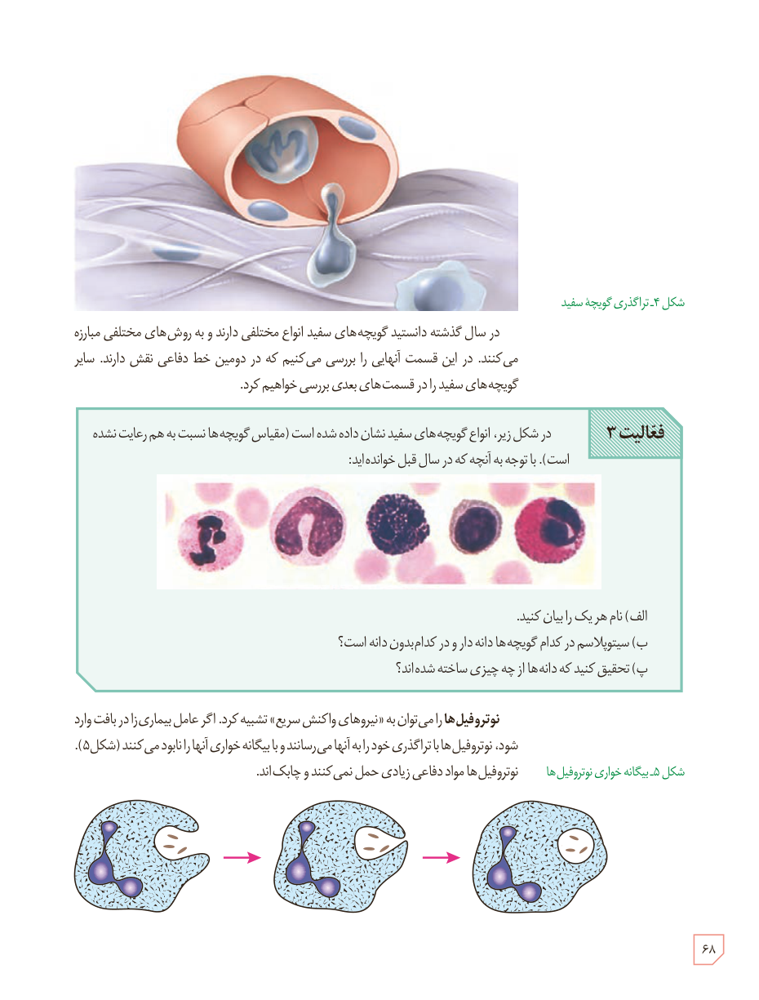

شکل ۴ـ تراگذری گویچۀ سفید

در سال گذشته دانستید گویچه‌های سفید انواع مختلفی دارند و به روش‌های مختلفی مبارزه می‌کنند. در این قسمت آنهایی را بررسی می‌کنیم که در دومین خط دفاعی نقش دارند. سایر گویچه‌های سفید را در قسمت‌های بعدی بررسی خواهیم کرد.

**فعالیت ۳:** در شکل زیر، انواع گویچه‌های سفید نشان داده شده است (مقیاس گویچه‌ها نسبت به هم رعایت نشده است). با توجه به آنچه که در سال قبل خوانده‌اید:  
الف) نام هر یک را بیان کنید.  
ب) سیتوپلاسم در کدام گویچه‌ها دانه‌دار و در کدام بدون دانه است؟  
پ) تحقیق کنید که دانه‌ها از چه چیزی ساخته شده‌اند؟

نوتروفیل‌ها را می‌توان به «نیروهای واکنش سریع» تشبیه کرد. اگر عامل بیماری‌زا در بافت وارد شود، نوتروفیل‌ها با تراگذری خود را به آنها می‌رسانند و با بیگانه‌خواری آنها را نابود می‌کنند (شکل ۵). نوتروفیل‌ها مواد دفاعی زیادی حمل نمی‌کنند و چابک‌اند.

شکل ۵ـ بیگانه‌خواری نوتروفیل‌ها

۶۸

