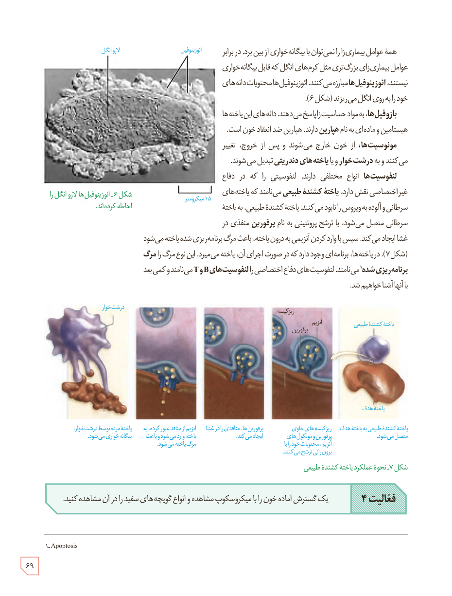

همۀ عوامل بیماری‌زا را نمی‌توان با بیگانه‌خواری از بین برد. در برابر عوامل بیماری‌زای بزرگ‌تری مثل کرم‌های انگل که قابل بیگانه‌خواری نیستند، ائوزینوفیل‌ها مبارزه می‌کنند. ائوزینوفیل‌ها محتویات دانه‌های خود را به روی انگل می‌ریزند (شکل ۶).

بازوفیل‌ها، به مواد حساسیت‌زا پاسخ می‌دهند. دانه‌های این یاخته‌ها هیستامین و ماده‌ای به نام هپارین دارند. هپارین ضد انعقاد خون است.

مونوسیت‌ها، از خون خارج می‌شوند و پس از خروج، تغییر می‌کنند و به درشت‌خوار و یا یاخته‌های دندریتی تبدیل می‌شوند.

لنفوسیت‌ها انواع مختلفی دارند. لنفوسیتی را که در دفاع غیراختصاصی نقش دارد، یاختۀ کشندۀ طبیعی می‌نامند که یاخته‌های سرطانی و آلوده به ویروس را نابود می‌کنند. یاختۀ کشندۀ طبیعی، به یاختۀ سرطانی متصل می‌شود، با ترشح پروتئینی به نام پرفورین منفذی در غشا ایجاد می‌کند. سپس با وارد کردن آنزیمی به درون یاخته، باعث مرگ برنامه‌ریزی شدۀ یاخته می‌شود (شکل ۷). در یاخته‌ها، برنامه‌ای وجود دارد که در صورت اجرای آن، یاخته می‌میرد. این نوع مرگ را مرگ برنامه‌ریزی شده¹ می‌نامند. لنفوسیت‌های دفاع اختصاصی را لنفوسیت‌های B و T می‌نامند و کمی بعد با آنها آشنا خواهیم شد.

شکل ۶ـ ائوزینوفیل‌ها لارو انگل را احاطه کرده‌اند. برچسب‌ها: لارو انگل، ائوزینوفیل، ۱۵ میکرومتر.

شکل ۷ـ نحوۀ عملکرد یاختۀ کشندۀ طبیعی. برچسب‌ها: یاختۀ کشندۀ طبیعی، یاختۀ هدف، ریزکیسه، آنزیم، پرفورین، درشت‌خوار. یاختۀ کشندۀ طبیعی به یاختۀ هدف متصل می‌شود. ریزکیسه‌های حاوی پرفورین و مولکول‌های آنزیم، محتویات خود را با برون‌رانی ترشح می‌کنند. پرفورین‌ها، منافذی را در غشا ایجاد می‌کنند. آنزیم از منافذ عبور کرده، به یاخته وارد می‌شود و باعث مرگ یاخته می‌شود. یاختۀ مرده توسط درشت‌خوار، بیگانه‌خواری می‌شود.

**فعالیت ۴:** یک گسترش آمادۀ خون را با میکروسکوپ مشاهده و انواع گویچه‌های سفید را در آن مشاهده کنید.

۱ـ Apoptosis

۶۹

