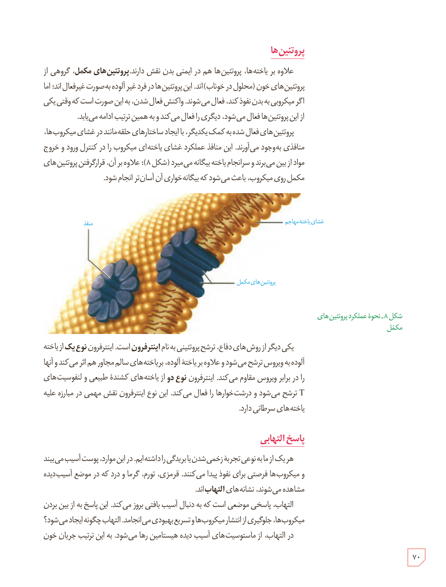

## پروتئین‌ها

علاوه بر یاخته‌ها، پروتئین‌ها هم در ایمنی بدن نقش دارند. پروتئین‌های مکمل، گروهی از پروتئین‌های خون (محلول در خوناب) اند. این پروتئین‌ها در فرد غیر آلوده به صورت غیرفعال‌اند؛ اما اگر میکروبی به بدن نفوذ کند، فعال می‌شوند. واکنش فعال شدن، به این صورت است که وقتی یکی از این پروتئین‌ها فعال می‌شود، دیگری را فعال می‌کند و به همین ترتیب ادامه می‌یابد.

پروتئین‌های فعال شده به کمک یکدیگر، با ایجاد ساختارهای حلقه‌مانند در غشای میکروب‌ها، منافذی به‌وجود می‌آورند. این منافذ عملکرد غشای یاخته‌ای میکروب را در کنترل ورود و خروج مواد از بین می‌برند و سرانجام یاختۀ بیگانه می‌میرد (شکل ۸)؛ علاوه بر آن، قرار گرفتن پروتئین‌های مکمل روی میکروب، باعث می‌شود که بیگانه‌خواری آن آسان‌تر انجام شود.

شکل ۸ـ نحوۀ عملکرد پروتئین‌های مکمل. برچسب‌ها: منفذ، غشای یاختۀ مهاجم، پروتئین‌های مکمل.

یکی دیگر از روش‌های دفاع، ترشح پروتئینی به نام اینترفرون است. اینترفرون نوع یک از یاختۀ آلوده به ویروس ترشح می‌شود و علاوه بر یاختۀ آلوده، بر یاخته‌های سالم مجاور هم اثر می‌کند و آنها را در برابر ویروس مقاوم می‌کند. اینترفرون نوع دو از یاخته‌های کشندۀ طبیعی و لنفوسیت‌های T ترشح می‌شود و درشت‌خوارها را فعال می‌کند. این نوع اینترفرون نقش مهمی در مبارزه علیه یاخته‌های سرطانی دارد.

## پاسخ التهابی

هر یک از ما به نوعی تجربۀ زخمی شدن یا بریدگی را داشته‌ایم. در این موارد، پوست آسیب می‌بیند و میکروب‌ها فرصتی برای نفوذ پیدا می‌کنند. قرمزی، تورم، گرما و درد که در موضع آسیب‌دیده مشاهده می‌شوند، نشانه‌های التهاب‌اند.

التهاب، پاسخی موضعی است که به دنبال آسیب بافتی بروز می‌کند. این پاسخ به از بین بردن میکروب‌ها، جلوگیری از انتشار میکروب‌ها و تسریع بهبودی می‌انجامد. التهاب چگونه ایجاد می‌شود؟ در التهاب، از ماستوسیت‌های آسیب‌دیده هیستامین رها می‌شود. به این ترتیب جریان خون

۷۰

