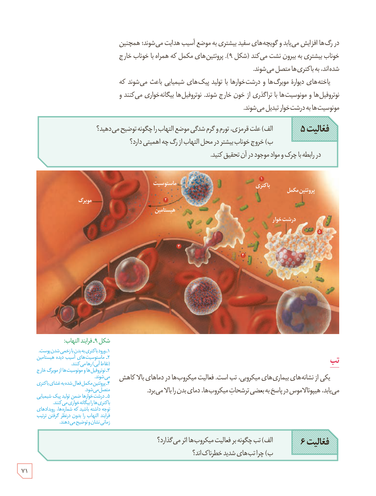

در رگ‌ها افزایش می‌یابد و گویچه‌های سفید بیشتری به موضع آسیب هدایت می‌شوند؛ همچنین خوناب بیشتری به بیرون نشت می‌کند (شکل ۹). پروتئین‌های مکمل که همراه با خوناب خارج شده‌اند، به باکتری‌ها متصل می‌شوند.

یاخته‌های دیوارۀ مویرگ‌ها و درشت‌خوارها با تولید پیک‌های شیمیایی باعث می‌شوند که نوتروفیل‌ها و مونوسیت‌ها با تراگذری از خون خارج شوند. نوتروفیل‌ها بیگانه‌خواری می‌کنند و مونوسیت‌ها به درشت‌خوار تبدیل می‌شوند.

**فعالیت ۵:** الف) علت قرمزی، تورم و گرم‌شدگی موضع التهاب را چگونه توضیح می‌دهید؟  
ب) خروج خوناب بیشتر در محل التهاب از رگ چه اهمیتی دارد؟  
در رابطه با چرک و مواد موجود در آن تحقیق کنید.

شکل ۹ـ فرایند التهاب: ۱ـ ورود باکتری به بدن با زخمی شدن پوست. ۲ـ ماستوسیت‌های آسیب‌دیده هیستامین (نقاط آبی) رها می‌کنند. ۳ـ نوتروفیل‌ها و مونوسیت‌ها از مویرگ خارج می‌شوند. ۴ـ پروتئین مکمل فعال شده به غشای باکتری متصل می‌شود. ۵ـ درشت‌خوارها ضمن تولید پیک شیمیایی باکتری‌ها را بیگانه‌خواری می‌کنند. توجه داشته باشید که شماره‌ها، رویدادهای فرایند التهاب را بدون در نظر گرفتن ترتیب زمانی نشان و توضیح می‌دهند. برچسب‌ها: مویرگ، ماستوسیت، هیستامین، باکتری، پروتئین مکمل، درشت‌خوار.

## تب

یکی از نشانه‌های بیماری‌های میکروبی، تب است. فعالیت میکروب‌ها در دماهای بالا کاهش می‌یابد، هیپوتالاموس در پاسخ به بعضی ترشحات میکروب‌ها، دمای بدن را بالا می‌برد.

**فعالیت ۶:** الف) تب چگونه بر فعالیت میکروب‌ها اثر می‌گذارد؟  
ب) چرا تب‌های شدید خطرناک‌اند؟

۷۱

