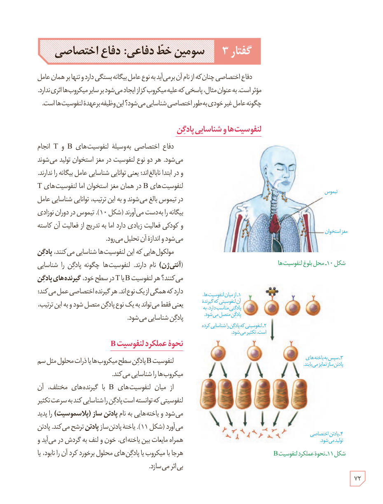

# گفتار ۳: سومین خط دفاعی: دفاع اختصاصی

دفاع اختصاصی چنان‌که از نام آن برمی‌آید به نوع عامل بیگانه بستگی دارد و تنها بر همان عامل مؤثر است. به عنوان مثال، پاسخی که علیه میکروب کزاز ایجاد می‌شود بر سایر میکروب‌ها اثری ندارد. چگونه عامل غیر خودی به طور اختصاصی شناسایی می‌شود؟ این وظیفه برعهدۀ لنفوسیت‌هاست.

## لنفوسیت‌ها و شناسایی پادگن

دفاع اختصاصی به‌وسیلۀ لنفوسیت‌های B و T انجام می‌شود. هر دو نوع لنفوسیت در مغز استخوان تولید می‌شوند و در ابتدا نابالغ‌اند؛ یعنی توانایی شناسایی عامل بیگانه را ندارند. لنفوسیت‌های B در همان مغز استخوان اما لنفوسیت‌های T در تیموس بالغ می‌شوند و به این ترتیب، توانایی شناسایی عامل بیگانه را به دست می‌آورند (شکل ۱۰). تیموس در دوران نوزادی و کودکی فعالیت زیادی دارد اما به تدریج از فعالیت آن کاسته می‌شود و اندازۀ آن تحلیل می‌رود.

مولکول‌هایی که این لنفوسیت‌ها شناسایی می‌کنند، پادگن (آنتی‌ژن) نام دارند. لنفوسیت‌ها چگونه پادگن را شناسایی می‌کنند؟ هر لنفوسیت B یا T در سطح خود، گیرنده‌های پادگن دارد که همگی از یک نوع‌اند. هر گیرنده اختصاصی عمل می‌کند؛ یعنی فقط می‌تواند به یک نوع پادگن متصل شود و به این ترتیب، پادگن شناسایی می‌شود.

شکل ۱۰ـ محل بلوغ لنفوسیت‌ها. برچسب‌ها: تیموس، مغز استخوان.

## نحوۀ عملکرد لنفوسیت B

لنفوسیت B پادگن سطح میکروب‌ها یا ذرات محلول مثل سم میکروب‌ها را شناسایی می‌کند.

از میان لنفوسیت‌های B با گیرنده‌های مختلف، آن لنفوسیتی که توانسته است پادگن را شناسایی کند به سرعت تکثیر می‌شود و یاخته‌هایی به نام پادتن‌ساز (پلاسموسیت) را پدید می‌آورد (شکل ۱۱). یاختۀ پادتن‌ساز پادتن ترشح می‌کند. پادتن همراه مایعات بین یاخته‌ای، خون و لنف به گردش در می‌آید و هرجا با میکروب یا پادگن‌های محلول برخورد کرد آن را نابود، یا بی‌اثر می‌سازد.

شکل ۱۱ـ نحوۀ عملکرد لنفوسیت B: ۱ـ از میان لنفوسیت‌ها، آن لنفوسیتی که گیرندۀ پادگنی مناسب دارد، به پادگن متصل می‌شود. ۲ـ لنفوسیتی که پادگن را شناسایی کرده است، تکثیر می‌شود. ۳ـ سپس به یاخته‌های پادتن‌ساز تمایز می‌یابند. ۴ـ پادتن اختصاصی تولید می‌شود.

۷۲

