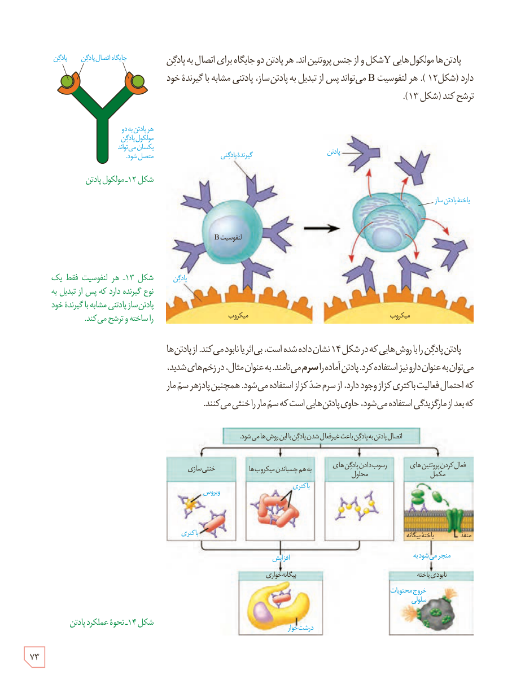

پادتن‌ها مولکول‌هایی Y شکل و از جنس پروتئین‌اند. هر پادتن دو جایگاه برای اتصال به پادگن دارد (شکل ۱۲). هر لنفوسیت B می‌تواند پس از تبدیل به پادتن‌ساز، پادتنی مشابه با گیرندۀ خود ترشح کند (شکل ۱۳).

شکل ۱۲ـ مولکول پادتن. برچسب‌ها: پادگن، جایگاه اتصال پادگن، هر پادتن به دو مولکول پادگن یکسان می‌تواند متصل شود.

شکل ۱۳ـ هر لنفوسیت فقط یک نوع گیرنده دارد که پس از تبدیل به پادتن‌ساز پادتنی مشابه با گیرندۀ خود را ساخته و ترشح می‌کند. برچسب‌ها: گیرندۀ پادگنی، پادتن، لنفوسیت B، یاختۀ پادتن‌ساز، پادگن، میکروب.

پادتن پادگن را با روش‌هایی که در شکل ۱۴ نشان داده شده است، بی‌اثر یا نابود می‌کند. از پادتن‌ها می‌توان به عنوان دارو نیز استفاده کرد. پادتن آماده را سرم می‌نامند. به عنوان مثال، در زخم‌های شدید، که احتمال فعالیت باکتری کزاز وجود دارد، از سرم ضد کزاز استفاده می‌شود. همچنین پادزهر سم مار که بعد از مارگزیدگی استفاده می‌شود، حاوی پادتن‌هایی است که سم مار را خنثی می‌کنند.

شکل ۱۴ـ نحوۀ عملکرد پادتن: اتصال پادتن به پادگن باعث غیرفعال شدن پادگن با این روش‌ها می‌شود: خنثی‌سازی، به هم چسباندن میکروب‌ها، رسوب دادن پادگن‌های محلول، فعال کردن پروتئین‌های مکمل. برچسب‌ها: ویروس، باکتری، افزایش بیگانه‌خواری، درشت‌خوار، منفذ، یاختۀ بیگانه، منفجر می‌شود، نابودی یاخته، خروج محتویات سلولی.

۷۳

