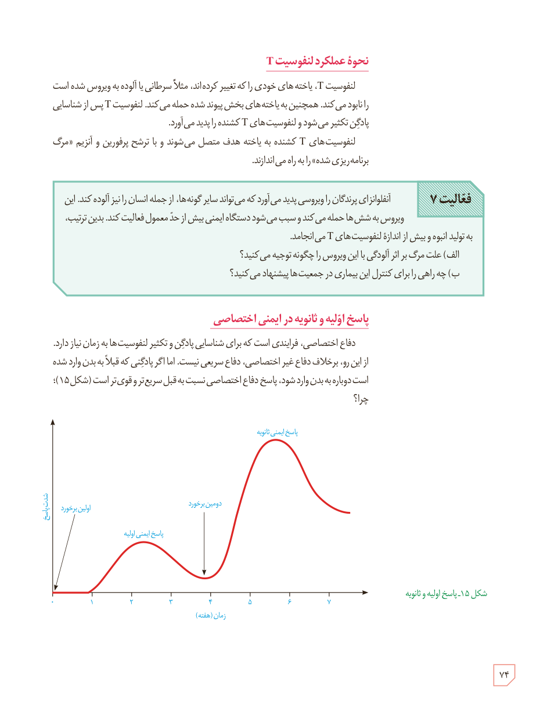

## نحوۀ عملکرد لنفوسیت T

لنفوسیت T، یاخته‌های خودی را که تغییر کرده‌اند، مثلاً سرطانی یا آلوده به ویروس شده است را نابود می‌کند. همچنین به یاخته‌های بخش پیوند شده حمله می‌کند. لنفوسیت T پس از شناسایی پادگن تکثیر می‌شود و لنفوسیت‌های T کشنده را پدید می‌آورد.

لنفوسیت‌های T کشنده به یاختۀ هدف متصل می‌شوند و با ترشح پرفورین و آنزیم «مرگ برنامه‌ریزی شده» را به راه می‌اندازند.

**فعالیت ۷:** آنفلوانزای پرندگان را ویروسی پدید می‌آورد که می‌تواند سایر گونه‌ها، از جمله انسان را نیز آلوده کند. این ویروس به شش‌ها حمله می‌کند و سبب می‌شود دستگاه ایمنی بیش از حد معمول فعالیت کند. بدین ترتیب، به تولید انبوه و بیش از اندازۀ لنفوسیت‌های T می‌انجامد.  
الف) علت مرگ بر اثر آلودگی با این ویروس را چگونه توجیه می‌کنید؟  
ب) چه راهی را برای کنترل این بیماری در جمعیت‌ها پیشنهاد می‌کنید؟

## پاسخ اولیه و ثانویه در ایمنی اختصاصی

دفاع اختصاصی، فرایندی است که برای شناسایی پادگن و تکثیر لنفوسیت‌ها به زمان نیاز دارد. از این رو، برخلاف دفاع غیر اختصاصی، دفاع سریع نیست. اما اگر پادگنی که قبلاً به بدن وارد شده است دوباره به بدن وارد شود، پاسخ دفاع اختصاصی نسبت به قبل سریع‌تر و قوی‌تر است (شکل ۱۵)؛ چرا؟

شکل ۱۵ـ پاسخ اولیه و ثانویه. محور عمودی: شدت پاسخ؛ محور افقی: زمان (هفته). برچسب‌ها: اولین برخورد، پاسخ ایمنی اولیه، دومین برخورد، پاسخ ایمنی ثانویه.

۷۴

