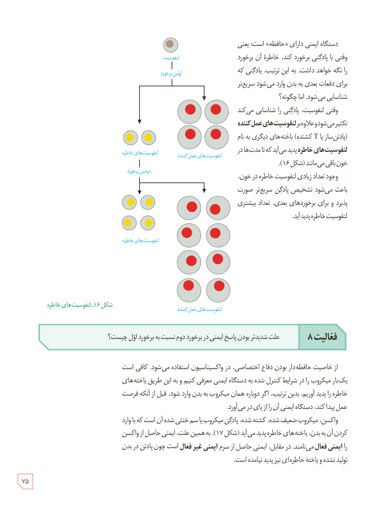

دستگاه ایمنی دارای «حافظه» است؛ یعنی وقتی با پادگنی برخورد کند، خاطرۀ آن برخورد را نگه خواهد داشت. به این ترتیب، پادگنی که برای دفعات بعدی به بدن وارد می‌شود سریع‌تر شناسایی می‌شود. اما چگونه؟

وقتی لنفوسیت، پادگنی را شناسایی می‌کند تکثیر می‌شود و علاوه بر لنفوسیت‌های عمل‌کننده (پادتن‌ساز یا T کشنده) یاخته‌های دیگری به نام لنفوسیت‌های خاطره پدید می‌آید که تا مدت‌ها در خون باقی می‌مانند (شکل ۱۶).

وجود تعداد زیادی لنفوسیت خاطره در خون، باعث می‌شود تشخیص پادگن سریع‌تر صورت پذیرد و برای برخوردهای بعدی، تعداد بیشتری لنفوسیت خاطره پدید آید.

شکل ۱۶ـ لنفوسیت‌های خاطره. برچسب‌ها: لنفوسیت، اولین برخورد، لنفوسیت‌های خاطره، لنفوسیت‌های عمل‌کننده، دومین برخورد.

**فعالیت ۸:** علت شدیدتر بودن پاسخ ایمنی در برخورد دوم نسبت به برخورد اول چیست؟

از خاصیت حافظه‌دار بودن دفاع اختصاصی، در واکسیناسیون استفاده می‌شود. کافی است یک‌بار میکروب را در شرایط کنترل شده به دستگاه ایمنی معرفی کنیم و به این طریق یاخته‌های خاطره را پدید آوریم. بدین ترتیب، اگر دوباره همان میکروب به بدن وارد شود، قبل از آنکه فرصت عمل پیدا کند، دستگاه ایمنی آن را از پای در می‌آورد.

واکسن، میکروب ضعیف شده، کشته شده، پادگن میکروب یا سم خنثی شدۀ آن است که با وارد کردن آن به بدن، یاخته‌های خاطره پدید می‌آید (شکل ۱۷). به همین علت، ایمنی حاصل از واکسن را ایمنی فعال می‌نامند. در مقابل، ایمنی حاصل از سرم ایمنی غیرفعال است چون پادتن در بدن تولید نشده و یاختۀ خاطره‌ای نیز پدید نیامده است.

۷۵

