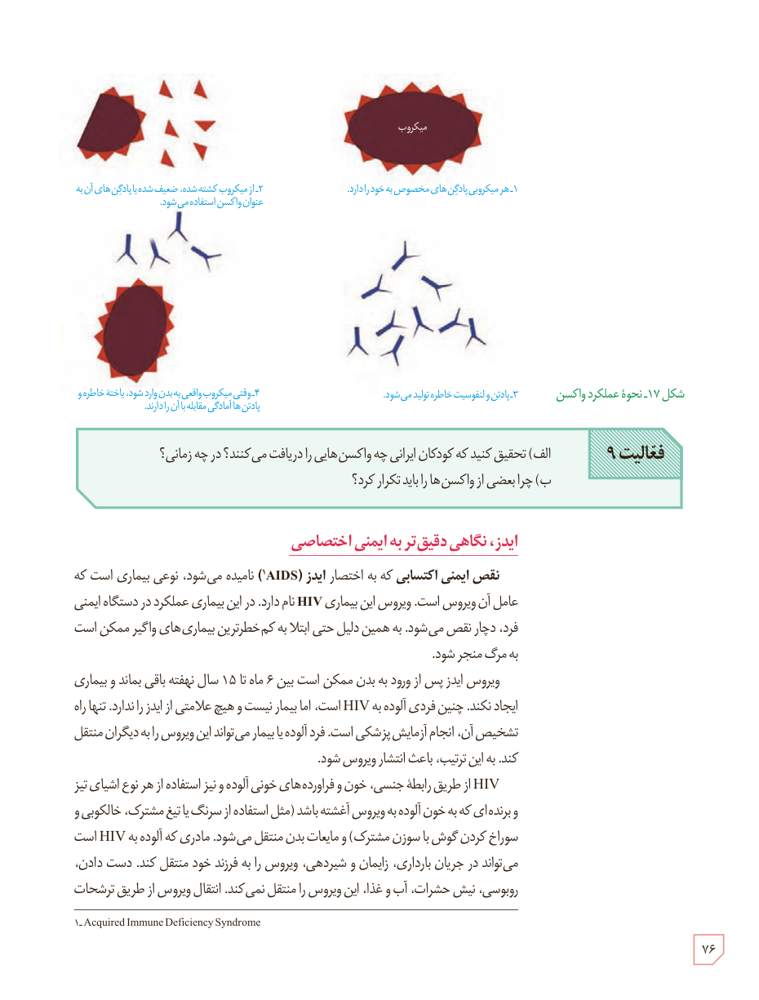

شکل ۱۷ـ نحوۀ عملکرد واکسن: ۱ـ هر میکروبی پادگن‌های مخصوص به خود را دارد. ۲ـ از میکروب کشته شده، ضعیف شده یا پادگن‌های آن به عنوان واکسن استفاده می‌شود. ۳ـ پادتن و لنفوسیت خاطره تولید می‌شود. ۴ـ وقتی میکروب واقعی به بدن وارد شود یاخته‌های خاطره و پادتن‌ها آمادگی مقابله با آن را دارند.

**فعالیت ۹:** الف) تحقیق کنید که کودکان ایرانی چه واکسن‌هایی را دریافت می‌کنند؟ در چه زمانی؟  
ب) چرا بعضی از واکسن‌ها را باید تکرار کرد؟

## ایدز، نگاهی دقیق‌تر به ایمنی اختصاصی

نقص ایمنی اکتسابی که به اختصار ایدز (AIDS)¹ نامیده می‌شود، نوعی بیماری است که عامل آن ویروس است. ویروس این بیماری HIV نام دارد. در این بیماری عملکرد دستگاه ایمنی فرد، دچار نقص می‌شود. به همین دلیل حتی ابتلا به کم‌خطرترین بیماری‌های واگیر ممکن است به مرگ منجر شود.

ویروس ایدز پس از ورود به بدن ممکن است بین ۶ ماه تا ۱۵ سال نهفته باقی بماند و بیماری ایجاد نکند. چنین فردی آلوده به HIV است، اما بیمار نیست و هیچ علامتی از ایدز را ندارد. تنها راه تشخیص آن، انجام آزمایش پزشکی است. فرد آلوده یا بیمار می‌تواند این ویروس را به دیگران منتقل کند. به این ترتیب، باعث انتشار ویروس شود.

HIV از طریق رابطۀ جنسی، خون و فرآورده‌های خونی آلوده و نیز استفاده از هر نوع اشیای تیز و برنده‌ای که به خون آلوده به ویروس آغشته باشد (مثل استفاده از سرنگ یا تیغ مشترک، خالکوبی و سوراخ کردن گوش با سوزن مشترک) و مایعات بدن منتقل می‌شود. مادری که آلوده به HIV است می‌تواند در جریان بارداری، زایمان و شیردهی، ویروس را به فرزند خود منتقل کند. دست دادن، روبوسی، نیش حشرات، آب و غذا، این ویروس را منتقل نمی‌کند. انتقال ویروس از طریق ترشحات

۱ـ Acquired Immune Deficiency Syndrome

۷۶

