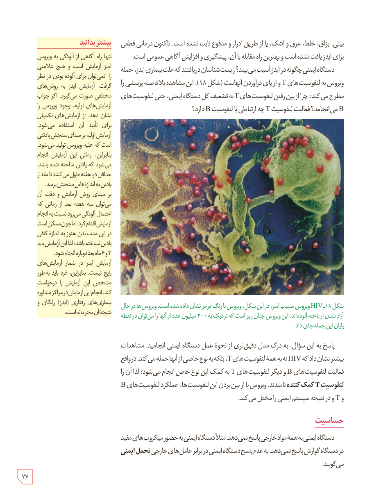

بینی، بزاق، خلط، عرق و اشک، یا از طریق ادرار و مدفوع ثابت نشده است. تاکنون درمانی قطعی برای ایدز یافت نشده است و بهترین راه مقابله با آن، پیشگیری و افزایش آگاهی عمومی است.

دستگاه ایمنی چگونه در ایدز آسیب می‌بیند؟ زیست‌شناسان دریافتند که علت بیماری ایدز، حملۀ ویروس به لنفوسیت‌های T و از پای درآوردن آنهاست (شکل ۱۸). این مشاهده بلافاصله پرسشی را مطرح می‌کند: چرا از بین رفتن لنفوسیت‌های T به تضعیف کل دستگاه ایمنی، حتی لنفوسیت‌های B می‌انجامد؟ فعالیت لنفوسیت T چه ارتباطی با لنفوسیت B دارد؟

شکل ۱۸ـ HIV ویروس مسبب ایدز: در این شکل، ویروس با رنگ قرمز نشان داده شده است. ویروس‌ها در حال آزاد شدن از یاختۀ آلوده‌اند. این ویروس چنان ریز است که نزدیک به ۲۰۰ میلیون عدد از آنها را می‌توان در نقطۀ پایان این جمله جای داد.

پاسخ به این سؤال، به درک مدل دقیق‌تری از نحوۀ عمل دستگاه ایمنی انجامید. مشاهدات بیشتر نشان داد که HIV نه به همۀ لنفوسیت‌های T، بلکه به نوع خاصی از آنها حمله می‌کند. در واقع فعالیت لنفوسیت‌های B و دیگر لنفوسیت‌های T به کمک این نوع خاص انجام می‌شود؛ لذا آن را لنفوسیت T کمک‌کننده نامیدند. ویروس با از بین بردن این لنفوسیت‌ها، عملکرد لنفوسیت‌های B و T و در نتیجه سیستم ایمنی را مختل می‌کند.

## حساسیت

دستگاه ایمنی به همۀ مواد خارجی پاسخ نمی‌دهد. مثلاً دستگاه ایمنی به حضور میکروب‌های مفید در دستگاه گوارش پاسخ نمی‌دهد. به عدم پاسخ دستگاه ایمنی در برابر عامل‌های خارجی تحمل ایمنی می‌گویند.

### بیشتر بدانید

تنها راه آگاهی از آلودگی به ویروس ایدز آزمایش است و هیچ علامتی را نمی‌توان برای آلوده بودن در نظر گرفت. آزمایش ایدز به روش‌های مختلفی صورت می‌گیرد. اگر جواب آزمایش‌های اولیه، وجود ویروس را نشان دهد، از آزمایش‌های تکمیلی برای تأیید آن استفاده می‌شود. آزمایش اولیه بر مبنای سنجش پادتنی است که علیه ویروس تولید می‌شود. بنابراین، زمانی این آزمایش انجام می‌شود که پادتن ساخته شده باشد. حداقل دو هفته طول می‌کشد تا مقدار پادتن به اندازۀ قابل سنجش برسد. بر مبنای روش آزمایش و دقت آن می‌توان سه هفته بعد از زمانی که احتمال آلودگی می‌رود نسبت به انجام آزمایش اقدام کرد. اما چون ممکن است در این مدت بدن هنوز به اندازۀ کافی پادتن نساخته باشد؛ لذا این آزمایش باید ۳ و ۶ ماه بعد دوباره انجام شود. آزمایش ایدز در شمار آزمایش‌های رایج نیست. بنابراین، فرد باید به طور مشخص این آزمایش را درخواست کند. انجام این آزمایش در مراکز مشاورۀ بیماری‌های رفتاری (ایدز) رایگان و نتیجۀ آن محرمانه است.

۷۷

