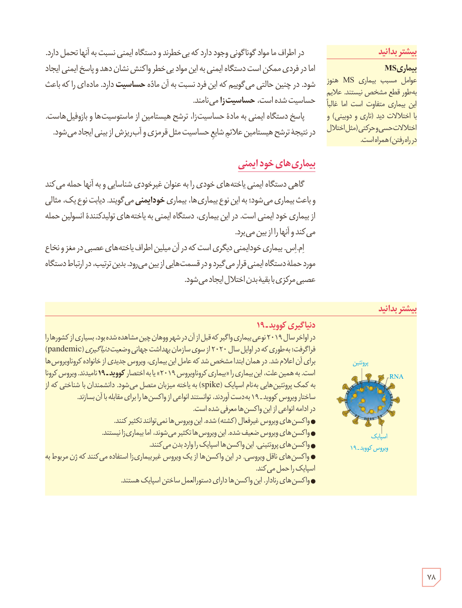

در اطراف ما مواد گوناگونی وجود دارد که بی‌خطرند و دستگاه ایمنی نسبت به آنها تحمل دارد. اما در فردی ممکن است دستگاه ایمنی به این مواد بی‌خطر واکنش نشان دهد و پاسخ ایمنی ایجاد شود. در چنین حالتی می‌گوییم که این فرد نسبت به آن ماده حساسیت دارد. ماده‌ای را که باعث حساسیت شده است، حساسیت‌زا می‌نامند.

پاسخ دستگاه ایمنی به مادۀ حساسیت‌زا، ترشح هیستامین از ماستوسیت‌ها و بازوفیل‌هاست. در نتیجۀ ترشح هیستامین علائم شایع حساسیت مثل قرمزی و آب‌ریزش از بینی ایجاد می‌شود.

## بیماری‌های خودایمنی

گاهی دستگاه ایمنی یاخته‌های خودی را به عنوان غیرخودی شناسایی و به آنها حمله می‌کند و باعث بیماری می‌شود؛ به این نوع بیماری‌ها، بیماری خودایمنی می‌گویند. دیابت نوع یک، مثالی از بیماری خودایمنی است. در این بیماری، دستگاه ایمنی به یاخته‌های تولیدکنندۀ انسولین حمله می‌کند و آنها را از بین می‌برد.

ام‌اس، بیماری خودایمنی دیگری است که در آن میلین اطراف یاخته‌های عصبی در مغز و نخاع مورد حملۀ دستگاه ایمنی قرار می‌گیرد و در قسمت‌هایی از بین می‌رود. بدین ترتیب، در ارتباط دستگاه عصبی مرکزی با بقیۀ بدن اختلال ایجاد می‌شود.

### بیشتر بدانید: بیماری MS

عوامل مسبب بیماری MS هنوز به‌طور قطع مشخص نیستند. علائم این بیماری متفاوت است اما غالباً با اختلالات دید (تاری و دوبینی) و اختلالات حسی و حرکتی (مثل اختلال در راه رفتن) همراه است.

### بیشتر بدانید: دنیاگیری کوویدـ۱۹

در اواخر سال ۲۰۱۹ نوعی بیماری واگیر که قبل از آن در شهر ووهان چین مشاهده شده بود، بسیاری از کشورها را فراگرفت؛ به‌طوری که در اوایل سال ۲۰۲۰ از سوی سازمان بهداشت جهانی وضعیت دنیاگیری (pandemic) برای آن اعلام شد. در همان ابتدا مشخص شد که عامل این بیماری، ویروس جدیدی از خانوادۀ کروناویروس‌ها است. به همین علت، این بیماری را «بیماری کروناویروس ۲۰۱۹» یا به اختصار کوویدـ۱۹ نامیدند. ویروس کرونا به کمک پروتئین‌هایی به‌نام اسپایک (spike) به یاختۀ میزبان متصل می‌شود. دانشمندان با شناختی که از ساختار ویروس کوویدـ۱۹ به‌دست آوردند، توانستند انواعی از واکسن‌ها را برای مقابله با آن بسازند. در ادامه انواعی از این واکسن‌ها معرفی شده است.

- واکسن‌های ویروس غیرفعال (کشته) شده. این ویروس‌ها نمی‌توانند تکثیر کنند.
- واکسن‌های ویروس ضعیف شده. این ویروس‌ها تکثیر می‌شوند، اما بیماری‌زا نیستند.
- واکسن‌های پروتئینی. این واکسن‌ها اسپایک را وارد بدن می‌کنند.
- واکسن‌های ناقل ویروسی. در این واکسن‌ها از یک ویروس غیربیماری‌زا استفاده می‌کنند که ژن مربوط به اسپایک را حمل می‌کند.
- واکسن‌های رِنادار. این واکسن‌ها دارای دستورالعمل ساختن اسپایک هستند.

برچسب‌های تصویر ویروس کوویدـ۱۹: پروتئین، RNA، اسپایک.

۷۸

