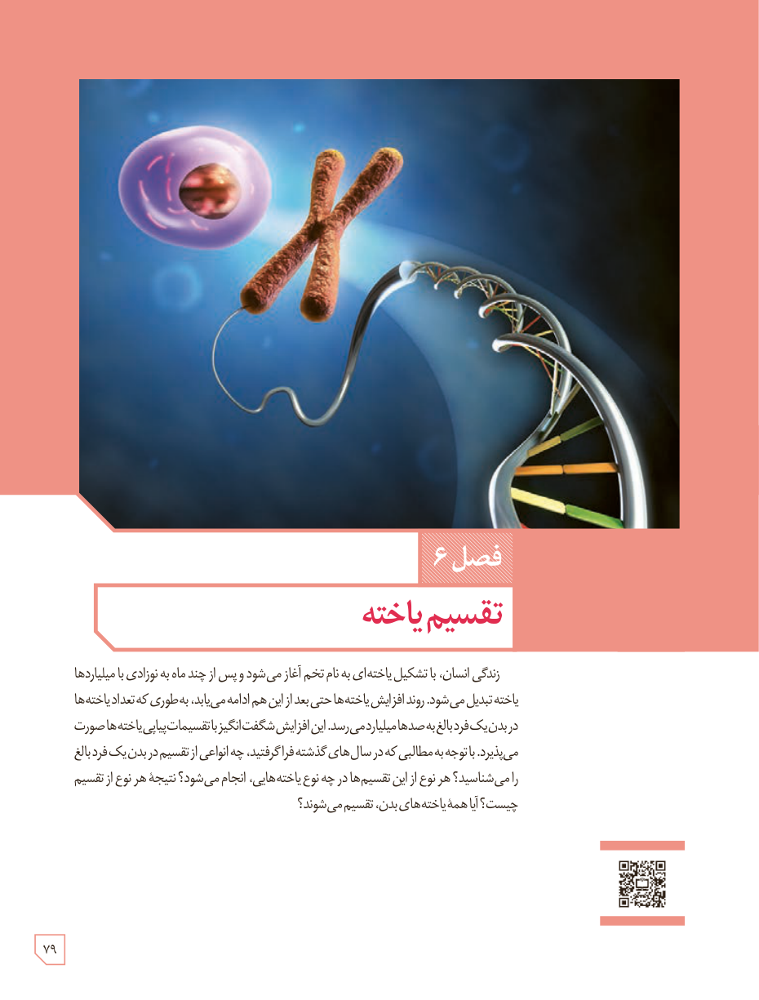

# فصل ۶: تقسیم یاخته

زندگی انسان، با تشکیل یاخته‌ای به نام تخم آغاز می‌شود و پس از چند ماه به نوزادی با میلیاردها یاخته تبدیل می‌شود. روند افزایش یاخته‌ها حتی بعد از این هم ادامه می‌یابد، به‌طوری که تعداد یاخته‌ها در بدن یک فرد بالغ به صدها میلیارد می‌رسد. این افزایش شگفت‌انگیز با تقسیمات پی‌درپی یاخته‌ها صورت می‌پذیرد. با توجه به مطالبی که در سال‌های گذشته فراگرفتید، چه انواعی از تقسیم در بدن یک فرد بالغ را می‌شناسید؟ هر نوع از این تقسیم‌ها در چه نوع یاخته‌هایی، انجام می‌شود؟ نتیجۀ هر نوع از تقسیم چیست؟ آیا همۀ یاخته‌های بدن، تقسیم می‌شوند؟

۷۹

