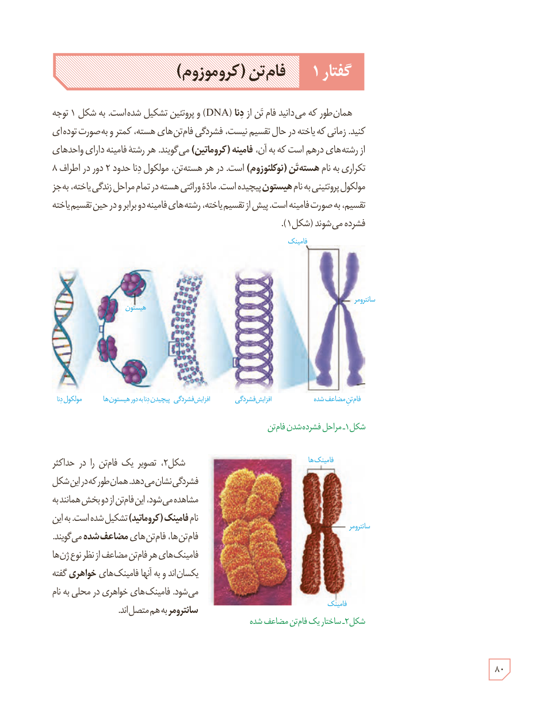

# گفتار ۱: فام‌تن (کروموزوم)

همان‌طور که می‌دانید فام‌تن از دنا (DNA) و پروتئین تشکیل شده است. به شکل ۱ توجه کنید. زمانی که یاخته در حال تقسیم نیست، فشردگی فام‌تن‌های هسته، کمتر و به صورت توده‌ای از رشته‌های درهم است که به آن، فامینه (کروماتین) می‌گویند. هر رشتۀ فامینه دارای واحدهای تکراری به نام هسته‌تن (نوکلئوزوم) است. در هر هسته‌تن، مولکول دنا حدود ۲ دور در اطراف ۸ مولکول پروتئینی به نام هیستون پیچیده است. مادۀ وراثتی هسته در تمام مراحل زندگی یاخته، به جز تقسیم، به صورت فامینه است. پیش از تقسیم یاخته، رشته‌های فامینه دو برابر و در حین تقسیم یاخته فشرده می‌شوند (شکل ۱).

شکل ۱ـ مراحل فشرده شدن فام‌تن. برچسب‌ها: مولکول دنا، هیستون، پیچیدن دنا به دور هیستون‌ها، افزایش فشردگی، فام‌تن مضاعف شده، فامینک، سانترومر.

شکل ۲، تصویر یک فام‌تن را در حداکثر فشردگی نشان می‌دهد. همان‌طور که در این شکل مشاهده می‌شود، این فام‌تن از دو بخش همانند به نام فامینک (کروماتید) تشکیل شده است. به این فام‌تن‌ها، فام‌تن‌های مضاعف شده می‌گویند. فامینک‌های هر فام‌تن مضاعف از نظر نوع ژن‌ها یکسان‌اند و به آنها فامینک‌های خواهری گفته می‌شود. فامینک‌های خواهری در محلی به نام سانترومر به هم متصل‌اند.

شکل ۲ـ ساختار یک فام‌تن مضاعف شده. برچسب‌ها: فامینک‌ها، سانترومر، فامینک.

۸۰

