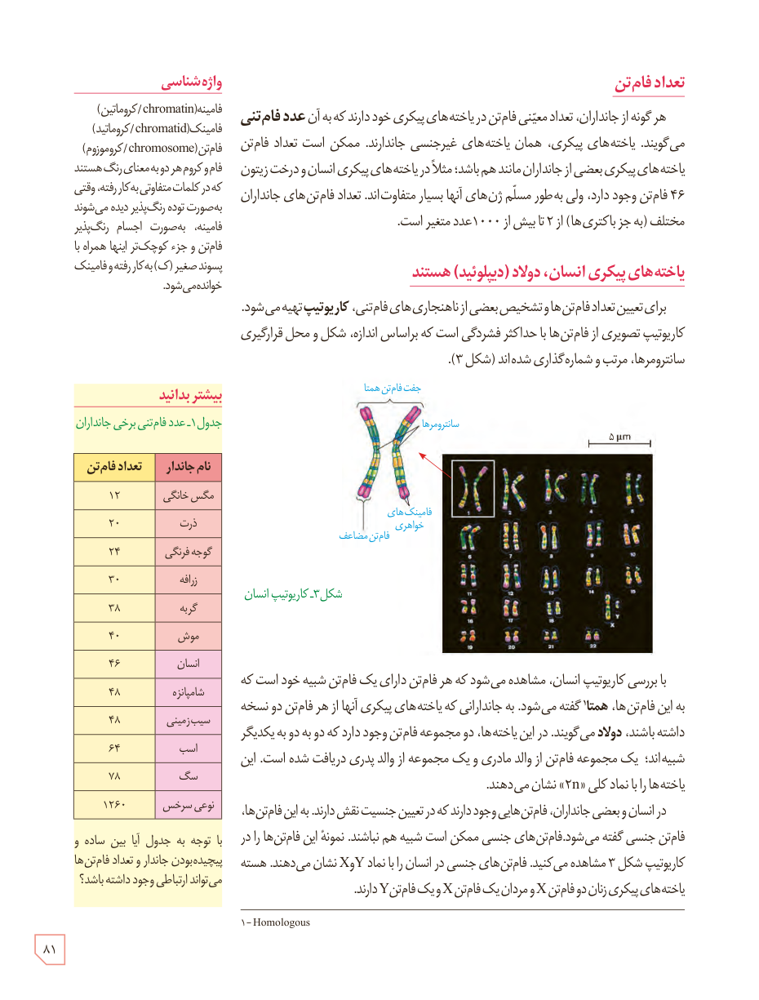

## تعداد فام‌تن

هر گونه از جانداران، تعداد معینی فام‌تن در یاخته‌های پیکری خود دارند که به آن عدد فام‌تنی می‌گویند. یاخته‌های پیکری، همان یاخته‌های غیرجنسی جاندارند. ممکن است تعداد فام‌تن یاخته‌های پیکری بعضی از جانداران مانند هم باشد؛ مثلاً در یاخته‌های پیکری انسان و درخت زیتون ۴۶ فام‌تن وجود دارد، ولی به‌طور مسلم ژن‌های آنها بسیار متفاوت‌اند. تعداد فام‌تن‌های جانداران مختلف (به جز باکتری‌ها) از ۲ تا بیش از ۱۰۰۰ عدد متغیر است.

## یاخته‌های پیکری انسان، دولاد (دیپلوئید) هستند

برای تعیین تعداد فام‌تن‌ها و تشخیص بعضی از ناهنجاری‌های فام‌تنی، کاریوتیپ تهیه می‌شود. کاریوتیپ تصویری از فام‌تن‌ها با حداکثر فشردگی است که براساس اندازه، شکل و محل قرارگیری سانترومرها، مرتب و شماره‌گذاری شده‌اند (شکل ۳).

شکل ۳ـ کاریوتیپ انسان. برچسب‌ها: جفت فام‌تن همتا، سانترومرها، فامینک‌های خواهری، فام‌تن مضاعف، ۵ μm.

با بررسی کاریوتیپ انسان، مشاهده می‌شود که هر فام‌تن دارای یک فام‌تن شبیه خود است که به این فام‌تن‌ها، همتا¹ گفته می‌شود. به جاندارانی که یاخته‌های پیکری آنها از هر فام‌تن دو نسخه داشته باشند، دولاد می‌گویند. در این یاخته‌ها، دو مجموعۀ فام‌تن وجود دارد که دو به دو به یکدیگر شبیه‌اند؛ یک مجموعه فام‌تن از والد مادری و یک مجموعه از والد پدری دریافت شده است. این یاخته‌ها را با نماد کلی «2n» نشان می‌دهند.

در انسان و بعضی جانداران، فام‌تن‌هایی وجود دارند که در تعیین جنسیت نقش دارند. به این فام‌تن‌ها، فام‌تن جنسی گفته می‌شود. فام‌تن‌های جنسی ممکن است شبیه هم نباشند. نمونۀ این فام‌تن‌ها را در کاریوتیپ شکل ۳ مشاهده می‌کنید. فام‌تن‌های جنسی در انسان را با نماد X و Y نشان می‌دهند. هسته یاخته‌های پیکری زنان دو فام‌تن X و مردان یک فام‌تن X و یک فام‌تن Y دارند.

### واژه‌شناسی

فامینه (chromatin/کروماتین)، فامینک (chromatid/کروماتید)، فام‌تن (chromosome/کروموزوم): فام و کروم هر دو به معنای رنگ هستند که در کلمات متفاوتی به‌کار رفته، وقتی به صورت تودۀ رنگ‌پذیر دیده می‌شوند فامینه، به‌صورت اجسام رنگ‌پذیر فام‌تن و جزء کوچکتر اینها همراه با پسوند صغیر (ک) به کار رفته و فامینک خوانده می‌شود.

### بیشتر بدانید: جدول ۱ـ عدد فام‌تنی برخی جانداران

| نام جاندار | تعداد فام‌تن |
|---|---:|
| مگس خانگی | ۱۲ |
| ذرت | ۲۰ |
| گوجه فرنگی | ۲۴ |
| زرافه | ۳۰ |
| گربه | ۳۸ |
| موش | ۴۰ |
| انسان | ۴۶ |
| شامپانزه | ۴۸ |
| سیب‌زمینی | ۴۸ |
| اسب | ۶۴ |
| سگ | ۷۸ |
| نوعی سرخس | ۱۲۶۰ |

با توجه به جدول آیا بین ساده و پیچیده بودن جاندار و تعداد فام‌تن‌ها می‌تواند ارتباطی وجود داشته باشد؟

۱ـ Homologous

۸۱

